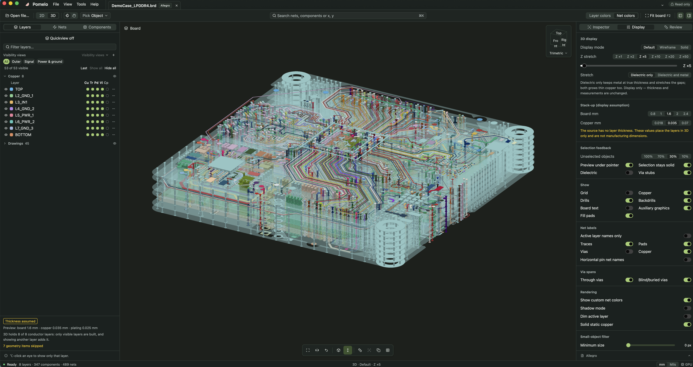
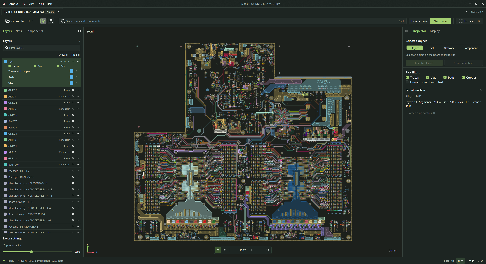

<p align="center">
  
</p>

<h1 align="center">Pomelo Desktop</h1>

<p align="center">
  <strong>Open any PCB. See every layer — in 2D and 3D.</strong><br>
  A fast, free, open-source PCB viewer for layout and SI/PI engineers.<br>
  Allegro, Altium, ODB++, PADS, KiCad and HFSS EDB files, read natively in Rust — no vendor tools, no uploads.
</p>

<p align="center">
  <a href="https://github.com/HaiwenZhang/Pomelo-Desktop/releases/latest"></a>
  <a href="https://github.com/HaiwenZhang/Pomelo-Desktop/actions/workflows/ci.yml"></a>
  
  
  <a href="LICENSE"></a>
</p>

<p align="center">English · <a href="README_zh-CN.md">简体中文</a> · <a href="README_zh-TW.md">繁體中文</a> · <a href="README_ja.md">日本語</a> · <a href="README_ko.md">한국어</a></p>



<p align="center"><a href="https://github.com/HaiwenZhang/Pomelo-Desktop/releases/latest"><b>⬇ Download for Windows, macOS or Linux</b></a> · <a href="#build-from-source">Build from source</a> · <a href="#what-you-can-do">Features</a></p>

## Why Pomelo

You get a board file from a colleague, a vendor or an old project, and you just want to *look* at it: trace a net, check a via, see what sits under a BGA. Usually that means installing a heavyweight EDA suite, finding a license, or uploading the design to someone's cloud.

Pomelo opens the file directly on your machine and draws it on the GPU.

- **Native readers, no vendor tools.** Every importer is written in Rust. Nothing calls out to Cadence, Altium or Ansys software, and no JavaScript engine is involved.
- **Your design stays yours.** Files never leave your computer, and Pomelo never writes to them.
- **Fast on real boards.** Traces, arcs, pads, copper with holes and board text render through native D3D11, Metal or Vulkan from one set of WGSL shaders. Boards with millions of objects stay interactive.
- **2D and 3D in one window.** Switch with one click and keep your place, your selection and your layer choices.

## What you can do

### Review layout in 2D

- **Find anything** — search nets and components, or type `x, y` to jump to a coordinate.
- **Control every layer** — a per-layer matrix of copper, traces, pads, vias and components, each filled, outlined or hidden; per-layer opacity; saved visibility views; single-layer mode with PageUp/PageDown.
- **Measure** — point-to-point, polyline, object clearance and pin-to-pin routed length along traces and vias.
- **Understand a net** — routed length per layer, which layers each via really connects, via stubs, the nearest reference planes and every pin, in one inspector card.
- **Compare lengths** — a net length table for a net and its differential partner or bus, with per-layer columns and deltas, copied as CSV.
- **See what is underneath** — the stack probe lists what every conductor layer holds under the pointer; the adjacent-plane view overlays the planes above and below a trace.
- **Share findings** — highlight groups, named views, navigation history, PNG/SVG export and copy-to-clipboard.

### Inspect the stack-up in 3D

- **Three display modes** — default (follows layer opacity), wireframe to see inside, and solid.
- **Stretch Z the way you need** — grow only the dielectric gaps so copper keeps its true thickness, or stretch everything; display only, readings never change.
- **Navigate like CAD** — view cube with nine standard views, orbit around the point under the pointer, right/middle-drag to pan, zoom at the pointer.
- **Focus on a signal** — isolate a net or component with the layers it uses; unselected objects fade; via stubs are marked.
- **Measure in 3D** — snaps to pad and via centers, trace ends and layer surfaces, with ΔX, ΔY and ΔZ.
- **Scale to big boards** — 3D builds only the layers you show and adds a layer when you turn it on. If memory runs short it lowers detail instead of failing, and tells you what it simplified.



### Everyday comfort

- Multiple boards in tabs, recent files with thumbnails, and per-board view state restored on reopen.
- English, 简体中文, 繁體中文, 日本語 and 한국어 interfaces; light and dark themes.
- Inferred groupings (differential pairs, buses, power and ground) and assumed stack thicknesses are always labeled as such — Pomelo shows facts and assumptions, it does not run DRC.

## Supported formats

| Tool | Files |
| --- | --- |
| Cadence Allegro | `.brd`, `.mcm` |
| Altium Designer | `.PcbDoc` |
| ODB++ | `.tgz`, `.tar`, `.tar.gz` |
| PADS | `.pcb` |
| KiCad | `.kicad_pcb` |
| Ansys HFSS 3D Layout / EDB | `edb.def` |

Coverage depends on the file version and the data it stores. Anything Pomelo cannot read yet is listed in the diagnostics panel rather than silently dropped — [tell us](https://github.com/HaiwenZhang/Pomelo-Desktop/issues) and attach the diagnostics.

## Install

Download the package for your platform from [Releases](https://github.com/HaiwenZhang/Pomelo-Desktop/releases/latest):

| Platform | Package |
| --- | --- |
| Windows 10/11 (x64, ARM64) | `.exe` installer |
| macOS 14+ (Apple silicon, Intel) | `.dmg` or `.app.zip` |
| Ubuntu 24.04+ (amd64, arm64) | `.deb` or `.tar.gz` |

macOS builds are ad-hoc signed: on first launch, right-click the app and choose **Open**.

Open a board with **Ctrl+O** (⌘O on macOS), by dropping it onto the window, or from the command line:

```sh
pomelo --locale en --encoding auto "board.brd"
```

`--locale` accepts `en`, `zh-CN`, `zh-TW`, `ja` and `ko` for this launch only. `--encoding` (`auto`, `utf-8`, `gbk`, `shift_jis`, `big5`, `windows-1252`) helps when names in older files decode incorrectly. Arguments after `--` are file paths.

## Shortcuts

| Action | Key |
| --- | --- |
| Open / close / reload | `Ctrl+O` / `Ctrl+W` / `Ctrl+R` |
| Search, or jump to `x, y` | `Ctrl+K` |
| Fit board | `F2` |
| Flip board | `B` |
| Single-layer mode / change active layer | `L` / `PageUp` `PageDown` |
| Measure distance / polyline / clearance | `M` / `P` / `C` |
| Pin-to-pin routed length | `Shift+L` |
| Box select / zoom to area | `S` / `Z` |
| Next overlapping object | `N` (2D), click again (3D) |
| Back / forward in view history | `Alt+←` / `Alt+→` |
| Toggle left / right panel | `Ctrl+B` / `Ctrl+Shift+B` |
| 3D: orbit / pan / zoom | left-drag / right- or middle-drag / wheel |

On macOS use ⌘ for Ctrl.

## Build from source

Requirements: Git and the pinned Rust **1.98.1** toolchain (installed automatically by `rustup`).

| Platform | Also needed |
| --- | --- |
| Windows | MSVC C++ build tools, Windows SDK, a Direct3D 11 GPU |
| macOS | Xcode Command Line Tools, a Metal-capable Mac |
| Linux | fontconfig, FreeType, xkbcommon, Wayland/X11, ALSA and OpenSSL development packages, a Vulkan driver |

```sh
git clone https://github.com/HaiwenZhang/Pomelo-Desktop.git
cd Pomelo-Desktop
cargo run -p pomelo --release --locked
```

Checks used by CI:

```sh
cargo fmt --all -- --check
cargo clippy --workspace --all-targets --locked -- -D warnings
cargo test --workspace --locked
```

`cargo run -p pomelo-import --bin pcb_inspect --locked -- --help` inspects files from the command line.

<details>
<summary>Release packaging</summary>

| Platform | Package | Command |
| --- | --- | --- |
| Windows x64 / ARM64 | `.exe` | `scripts\build-windows.bat` (`--arch arm64`) |
| macOS arm64 / x64 | `.dmg`, `.app.zip` | `scripts/build-macos.sh` |
| Ubuntu 24.04+ amd64 / arm64 | `.deb`, `.tar.gz` | `scripts/build-ubuntu.sh` |

macOS packaging needs ImageMagick, Windows needs Inno Setup 6, Ubuntu needs `dpkg-dev` and `desktop-file-utils`. Output goes to `dist`. The scripts accept `--offline`, `--toolchain NAME`, `--output-dir PATH` and `--binary PATH`. macOS builds default to ad-hoc signing (`MACOS_SIGNING_IDENTITY` selects a keychain identity) with a macOS 14.0 minimum. Ubuntu releases are built on 24.04 to keep its ABI baseline.

Pushing a `vX.Y.Z` tag that matches the workspace version runs the [release workflow](.github/workflows/release.yml), which builds every platform and publishes the packages with `SHA256SUMS`.

</details>

## How it works

| Crate | Role |
| --- | --- |
| [pomelo-import](crates/pomelo-import) | Native Rust readers for every format, with structured diagnostics |
| [pomelo-core](crates/pomelo-core) | Board model, search, selection, net analysis, review tools and localization |
| [pomelo-render](crates/pomelo-render) | 2D and 3D scene preparation; D3D11, Metal and wgpu renderers from shared WGSL shaders (naga translates to HLSL and MSL) |
| [pomelo](crates/pomelo) | The desktop app, built on [GPUI](https://github.com/zed-industries/zed/tree/main/crates/gpui) and [GPUI Kit](https://github.com/longbridge/gpui-kit) |

Design notes live in [docs](docs/README.md), including the [2D/3D viewer plan](docs/viewer-2d-3d-unified-ui-plan.md), [3D rendering design](docs/pcb-3d-rendering-design.md) and [GPU backends](docs/native-gpu-backends.md).

## Status and roadmap

Pomelo is under active development. Format coverage, rendering fidelity and platform stability are still being validated, so compare against your source tool before relying on a reading.

Next up:

- Real stack-up thickness and materials from the source file, and multi-zone stack-ups
- Clip planes and cross-sections in 3D
- Linked 2D/3D split view
- Component bodies from package heights and 3D models
- Region-based 3D loading for boards that are huge even on one layer

Pomelo stays a viewer: it does not edit designs, route or run DRC.

## Contributing

Every board file that opens a little better helps everyone. Good places to start:

- **Format compatibility** — [open an issue](https://github.com/HaiwenZhang/Pomelo-Desktop/issues) with the source tool and version, your OS and GPU, what you expected, and the import diagnostics. A small sample or a screenshot from the source tool helps; remove confidential data first.
- **Rendering and performance** — before/after screenshots for visual changes, timings for large boards.
- **Translations** — all interface text lives in [locales](locales); the five README files are kept in sync.

Parser and geometry changes come with focused regression tests. See [development progress](docs/development-progress.md) and [validation guide](docs/validation-guide.md).

If Pomelo saves you from installing an EDA suite just to look at a board, **a ⭐ helps others find it.**

## License

Copyright (c) 2026 HaiwenZhang. Licensed under the [Apache License 2.0](LICENSE). Bundled fonts keep their own licenses; see [Source Han Sans](assets/fonts/source-han-sans/README.md).

## Acknowledgments

Built on [GPUI](https://github.com/zed-industries/zed/tree/main/crates/gpui) and [GPUI Kit](https://github.com/longbridge/gpui-kit).
