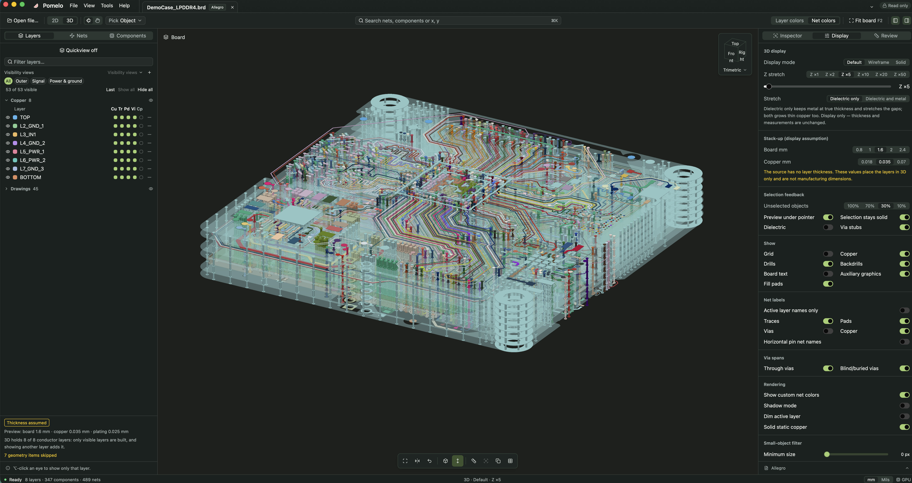
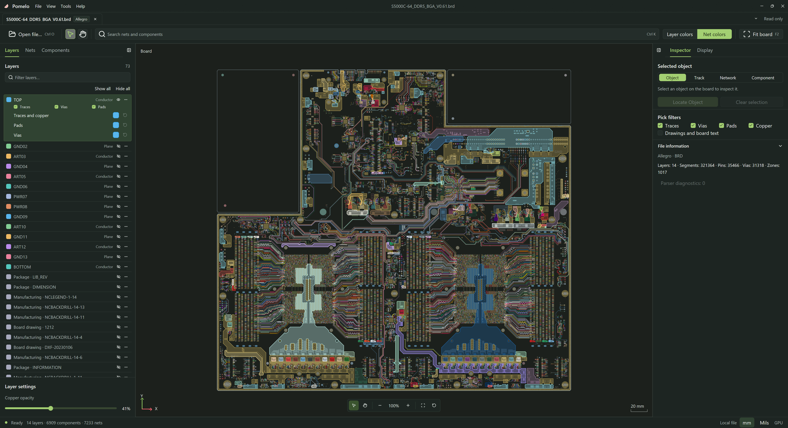

<p align="center">
  
</p>

<h1 align="center">Pomelo Desktop</h1>

<p align="center">
  <strong>どんな PCB も開いて、2D と 3D で全レイヤーを見渡す。</strong><br>
  レイアウト技術者と SI/PI 技術者のための、無料でオープンソースの高速 PCB ビューアー。<br>
  Allegro・Altium・ODB++・PADS・KiCad・HFSS EDB のファイルを Rust でネイティブに読み込みます。ベンダーツールもアップロードも不要です。
</p>

<p align="center">
  <a href="https://github.com/HaiwenZhang/Pomelo-Desktop/releases/latest"></a>
  <a href="https://github.com/HaiwenZhang/Pomelo-Desktop/actions/workflows/ci.yml"></a>
  
  
  <a href="LICENSE"></a>
</p>

<p align="center"><a href="README.md">English</a> · <a href="README_zh-CN.md">简体中文</a> · <a href="README_zh-TW.md">繁體中文</a> · 日本語 · <a href="README_ko.md">한국어</a></p>



<p align="center"><a href="https://github.com/HaiwenZhang/Pomelo-Desktop/releases/latest"><b>⬇ Windows・macOS・Linux 版をダウンロード</b></a> · <a href="#ソースからビルド">ソースからビルド</a> · <a href="#できること">機能</a></p>

## Pomelo を選ぶ理由

同僚や取引先、過去のプロジェクトから基板ファイルが届いて、ただ**見たい**だけのことがあります。ネットを追う、ビアを確かめる、BGA の下に何が通っているか見る。普通はそのために大きな EDA ツールを入れ、ライセンスを探し、あるいは設計を誰かのクラウドにアップロードすることになります。

Pomelo はファイルを手元のコンピューターで直接開き、GPU で描画します。

- **ネイティブ読み込み、ベンダーツール不要。** インポーターはすべて Rust 製です。Cadence・Altium・Ansys のソフトウェアを呼び出さず、JavaScript エンジンも使いません。
- **設計データは手元に。** ファイルがコンピューターの外に出ることはなく、Pomelo が元ファイルに書き込むこともありません。
- **実際の大規模基板でも快適。** 配線・円弧・パッド・穴あき銅箔・基板文字を、共通の WGSL シェーダーから D3D11・Metal・Vulkan でネイティブに描画します。数百万オブジェクトの基板でも滑らかに操作できます。
- **2D と 3D を同じウィンドウで。** ワンクリックで切り替えても、位置・選択・レイヤー設定はそのままです。

## できること

### 2D でレイアウトをレビュー

- **すばやく探す**：ネットや部品を検索、または `x, y` を入力して座標へジャンプ。
- **全レイヤーを管理**：導体層ごとのマトリクスで銅箔・配線・パッド・ビア・部品をそれぞれ塗り・輪郭・非表示に切り替え。レイヤーごとの不透明度、表示ビューの保存、PageUp/PageDown で切り替える単層モード。
- **測定**：2 点間距離、折れ線、オブジェクト間クリアランス、配線とビアに沿ったピン間経路長。
- **ネットを読み解く**：層ごとの配線長、各ビアが実際につなぐ層、ビアスタブ、上下の最寄りリファレンスプレーン、全ピンを検査カード 1 枚で確認。
- **長さを比べる**：ネット長テーブルで選択ネットと差動ペアやバスを並べ、層ごとの長さと差分を表示。CSV でコピーできます。
- **下にあるものを見る**：積層プローブがポインター下の各導体層の内容を一覧表示。隣接プレーン表示は配線の上下のプレーンを重ねて見せます。
- **結果を共有**：ハイライトグループ、名前付きビュー、表示履歴、PNG/SVG 書き出し、クリップボードへのコピー。

### 3D で積層を確認

- **3 つの表示モード**：標準（レイヤーの不透明度に従う）、内部が見えるワイヤーフレーム、ソリッド。
- **必要に応じた Z 伸長**：誘電体の層間だけを広げて銅は実際の厚さのまま、または全体を伸長。表示のみで測定値は変わりません。
- **CAD と同じ操作感**：9 つの標準方向を持つビューキューブ、ポインター位置を中心とした回転、右・中ドラッグで移動、ポインター位置でズーム。
- **信号に集中**：ネットや部品と、それが通る層だけを分離表示。未選択のオブジェクトは薄くなり、ビアスタブは別に示します。
- **3D 測定**：パッド中心・ビア中心・配線端・層表面にスナップし、ΔX・ΔY・ΔZ を表示。
- **大規模設計にも対応**：3D は表示中の層だけを生成し、層を表示すると自動で追加します。メモリが足りないときは失敗せずに細部を落とし、何を簡略化したかを表示します。



### 毎日使いやすく

- タブによる複数基板、サムネイル付きの最近使ったファイル、基板ごとの表示状態を再オープン時に復元。
- 日本語・English・简体中文・繁體中文・한국어 の UI、ライト／ダークテーマ。
- 推定したグループ（差動ペア・バス・電源と GND）や仮定の積層厚は必ずその旨を表示します。Pomelo は事実と仮定を示すもので、DRC は行いません。

## 対応形式

| ツール | ファイル |
| --- | --- |
| Cadence Allegro | `.brd`、`.mcm` |
| Altium Designer | `.PcbDoc` |
| ODB++ | `.tgz`、`.tar`、`.tar.gz` |
| PADS | `.pcb` |
| KiCad | `.kicad_pcb` |
| Ansys HFSS 3D Layout / EDB | `edb.def` |

読み込める範囲はファイルのバージョンと保存データによって異なります。まだ読めない内容は黙って捨てずに診断パネルに表示します。[Issue で教えてください](https://github.com/HaiwenZhang/Pomelo-Desktop/issues)。診断情報を添えていただけると助かります。

## インストール

[Releases](https://github.com/HaiwenZhang/Pomelo-Desktop/releases/latest) からお使いのプラットフォーム用パッケージをダウンロードしてください。

| プラットフォーム | パッケージ |
| --- | --- |
| Windows 10/11（x64・ARM64） | `.exe` インストーラー |
| macOS 14+（Apple シリコン・Intel） | `.dmg` または `.app.zip` |
| Ubuntu 24.04+（amd64・arm64） | `.deb` または `.tar.gz` |

macOS 版は ad-hoc 署名です。初回はアプリを右クリックして「開く」を選んでください。

**Ctrl+O**（macOS は ⌘O）、ウィンドウへのドラッグ＆ドロップ、またはコマンドラインで基板を開きます。

```sh
pomelo --locale ja --encoding auto "board.brd"
```

`--locale` は `en`・`zh-CN`・`zh-TW`・`ja`・`ko` を受け付け、その起動にのみ適用されます。`--encoding`（`auto`・`utf-8`・`gbk`・`shift_jis`・`big5`・`windows-1252`）は古いファイルの名前が正しく表示されない場合に使います。`--` 以降の引数はファイルパスとして扱います。

## ショートカット

| 操作 | キー |
| --- | --- |
| 開く / 閉じる / 再読み込み | `Ctrl+O` / `Ctrl+W` / `Ctrl+R` |
| 検索、または `x, y` へジャンプ | `Ctrl+K` |
| 基板全体を表示 | `F2` |
| 基板を反転 | `B` |
| 単層モード / アクティブ層の切替 | `L` / `PageUp` `PageDown` |
| 距離 / 折れ線 / クリアランスを測定 | `M` / `P` / `C` |
| ピン間経路長 | `Shift+L` |
| 範囲選択 / 範囲ズーム | `S` / `Z` |
| 次の重なったオブジェクト | `N`（2D）、もう一度クリック（3D） |
| 表示履歴を戻る / 進む | `Alt+←` / `Alt+→` |
| 左 / 右パネルの切替 | `Ctrl+B` / `Ctrl+Shift+B` |
| 3D：回転 / 移動 / ズーム | 左ドラッグ / 右または中ドラッグ / ホイール |

macOS では Ctrl の代わりに ⌘ を使います。

## ソースからビルド

Git と、リポジトリで固定された Rust **1.98.1** ツールチェーンが必要です（`rustup` が自動でインストールします）。

| プラットフォーム | 追加で必要なもの |
| --- | --- |
| Windows | MSVC C++ ビルドツール、Windows SDK、Direct3D 11 対応 GPU |
| macOS | Xcode Command Line Tools、Metal 対応の Mac |
| Linux | fontconfig・FreeType・xkbcommon・Wayland/X11・ALSA・OpenSSL の開発パッケージと Vulkan ドライバー |

```sh
git clone https://github.com/HaiwenZhang/Pomelo-Desktop.git
cd Pomelo-Desktop
cargo run -p pomelo --release --locked
```

CI で使うチェック：

```sh
cargo fmt --all -- --check
cargo clippy --workspace --all-targets --locked -- -D warnings
cargo test --workspace --locked
```

`cargo run -p pomelo-import --bin pcb_inspect --locked -- --help` でコマンドラインからファイルを調べられます。

<details>
<summary>リリースパッケージ</summary>

| プラットフォーム | パッケージ | コマンド |
| --- | --- | --- |
| Windows x64 / ARM64 | `.exe` | `scripts\build-windows.bat`（`--arch arm64`） |
| macOS arm64 / x64 | `.dmg`、`.app.zip` | `scripts/build-macos.sh` |
| Ubuntu 24.04+ amd64 / arm64 | `.deb`、`.tar.gz` | `scripts/build-ubuntu.sh` |

macOS のパッケージ作成には ImageMagick、Windows には Inno Setup 6、Ubuntu には `dpkg-dev` と `desktop-file-utils` が必要です。出力先は `dist` です。スクリプトは `--offline`・`--toolchain NAME`・`--output-dir PATH`・`--binary PATH` を受け付けます。macOS は既定で ad-hoc 署名（`MACOS_SIGNING_IDENTITY` でキーチェーンの署名 ID を指定）、最小バージョンは macOS 14.0 です。Ubuntu 版は ABI の基準を保つため 24.04 でビルドします。

ワークスペースのバージョンと一致する `vX.Y.Z` タグをプッシュすると[リリースワークフロー](.github/workflows/release.yml)が全プラットフォームをビルドし、パッケージと `SHA256SUMS` を公開します。

</details>

## 仕組み

| クレート | 役割 |
| --- | --- |
| [pomelo-import](crates/pomelo-import) | 各形式のネイティブ Rust リーダーと構造化された診断 |
| [pomelo-core](crates/pomelo-core) | 基板モデル、検索、選択、ネット解析、レビューツール、多言語対応 |
| [pomelo-render](crates/pomelo-render) | 2D/3D のシーン準備と、共通 WGSL シェーダーによる D3D11・Metal・wgpu レンダラー（naga で HLSL と MSL に変換） |
| [pomelo](crates/pomelo) | [GPUI](https://github.com/zed-industries/zed/tree/main/crates/gpui) と [GPUI Kit](https://github.com/longbridge/gpui-kit) で作ったデスクトップアプリ |

設計資料は [docs](docs/README.md) にあります。[2D/3D 統合ビューアー計画](docs/viewer-2d-3d-unified-ui-plan.md)、[3D 描画設計](docs/pcb-3d-rendering-design.md)、[GPU バックエンド](docs/native-gpu-backends.md) など。

## 状況とロードマップ

Pomelo は活発に開発中です。形式の互換性、表示精度、各プラットフォームでの安定性はまだ検証中のため、数値に頼る前に元のツールと照らし合わせてください。

次の予定：

- 元ファイルの実際の積層厚と材料の読み込み、マルチゾーン積層
- 3D のクリップ面と断面
- 連動する 2D/3D 分割表示
- パッケージ高さと 3D モデルによる部品表示
- 1 層だけでも巨大な基板向けの領域単位の 3D 読み込み

Pomelo はあくまでビューアーです。設計の編集、配線、DRC は行いません。

## 貢献

開ける基板ファイルが 1 つ増えるたびに、みんなが助かります。始めやすいところ：

- **形式の互換性**：[Issue を作成](https://github.com/HaiwenZhang/Pomelo-Desktop/issues)し、元のツールとバージョン、OS と GPU、期待した結果、インポート診断を書いてください。小さなサンプルや元ツールのスクリーンショットがあると助かります。共有前に機密データは取り除いてください。
- **描画と性能**：見た目の変更には前後のスクリーンショット、大規模基板の変更には所要時間を添えてください。
- **翻訳**：UI の文言はすべて [locales](locales) にあります。5 つの README は同期して管理しています。

パーサーやジオメトリの変更には、対象を絞った回帰テストを付けてください。[開発状況](docs/development-progress.md)と[検証ガイド](docs/validation-guide.md)も参照してください。

基板をちょっと見るためだけに EDA ツールを入れずに済んだなら、**⭐ を付けていただけると他の人も見つけやすくなります。**

## ライセンス

Copyright (c) 2026 HaiwenZhang。プロジェクトのコードは [Apache License 2.0](LICENSE) で提供されます。同梱フォントはそれぞれのライセンスに従います。[Source Han Sans](assets/fonts/source-han-sans/README.md) を参照してください。

## 謝辞

[GPUI](https://github.com/zed-industries/zed/tree/main/crates/gpui) と [GPUI Kit](https://github.com/longbridge/gpui-kit) の上に作られています。
