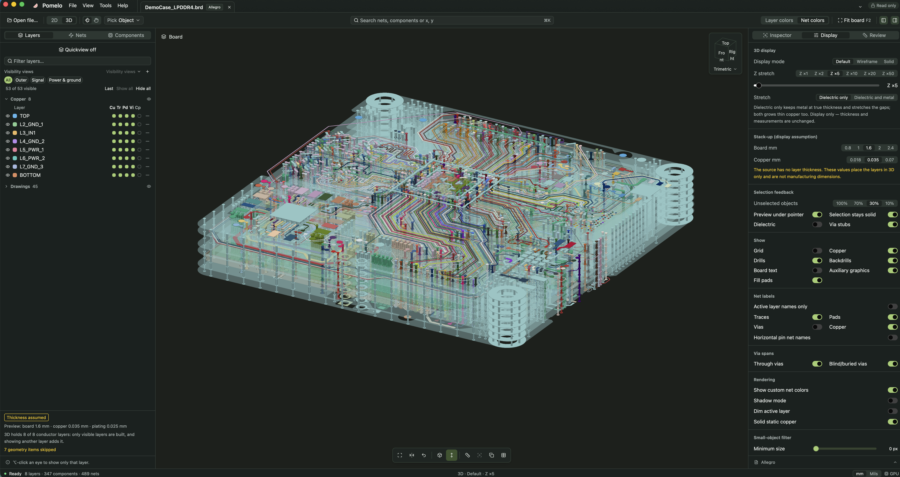
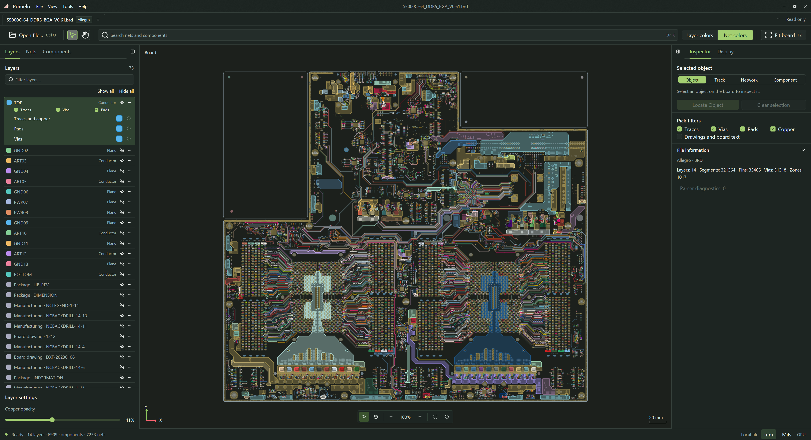

<p align="center">
  
</p>

<h1 align="center">Pomelo Desktop</h1>

<p align="center">
  <strong>어떤 PCB든 열고, 2D와 3D로 모든 레이어를 살펴보세요.</strong><br>
  레이아웃 엔지니어와 SI/PI 엔지니어를 위한 빠르고 무료인 오픈 소스 PCB 뷰어.<br>
  Allegro, Altium, ODB++, PADS, KiCad, HFSS EDB 파일을 Rust로 직접 읽습니다. 벤더 도구도, 업로드도 필요 없습니다.
</p>

<p align="center">
  <a href="https://github.com/HaiwenZhang/Pomelo-Desktop/releases/latest"></a>
  <a href="https://github.com/HaiwenZhang/Pomelo-Desktop/actions/workflows/ci.yml"></a>
  
  
  <a href="LICENSE"></a>
</p>

<p align="center"><a href="README.md">English</a> · <a href="README_zh-CN.md">简体中文</a> · <a href="README_zh-TW.md">繁體中文</a> · <a href="README_ja.md">日本語</a> · 한국어</p>



<p align="center"><a href="https://github.com/HaiwenZhang/Pomelo-Desktop/releases/latest"><b>⬇ Windows, macOS, Linux용 다운로드</b></a> · <a href="#소스에서-빌드">소스에서 빌드</a> · <a href="#할-수-있는-일">기능</a></p>

## 왜 Pomelo인가

동료나 협력사, 예전 프로젝트에서 기판 파일을 받았는데 그냥 **보기만** 하고 싶을 때가 있습니다. 넷을 따라가고, 비아를 확인하고, BGA 아래에 무엇이 지나가는지 보는 것이죠. 보통은 그러려고 무거운 EDA 도구를 설치하고, 라이선스를 찾고, 설계를 누군가의 클라우드에 올려야 합니다.

Pomelo는 파일을 내 컴퓨터에서 바로 열고 GPU로 그립니다.

- **네이티브 리더, 벤더 도구 불필요.** 모든 가져오기 기능은 Rust로 작성되었습니다. Cadence, Altium, Ansys 소프트웨어를 호출하지 않으며 JavaScript 엔진도 쓰지 않습니다.
- **설계는 내 컴퓨터에.** 파일은 컴퓨터 밖으로 나가지 않고, Pomelo는 원본 파일에 절대 쓰지 않습니다.
- **실제 대형 기판에서도 빠르게.** 배선, 원호, 패드, 구멍 있는 동박, 기판 문자를 하나의 WGSL 셰이더로 D3D11, Metal, Vulkan에서 네이티브로 그립니다. 수백만 개 개체가 있는 기판도 부드럽게 다룰 수 있습니다.
- **2D와 3D를 한 창에서.** 한 번의 클릭으로 전환해도 위치, 선택, 레이어 설정이 그대로 유지됩니다.

## 할 수 있는 일

### 2D로 레이아웃 검토

- **빠르게 찾기**: 넷과 부품을 검색하거나 `x, y`를 입력해 좌표로 이동합니다.
- **모든 레이어 제어**: 도체층마다 동박, 배선, 패드, 비아, 부품을 각각 채우기, 윤곽선, 숨김으로 바꾸는 매트릭스, 레이어별 불투명도, 저장 가능한 표시 보기, PageUp/PageDown으로 넘기는 단일 레이어 모드.
- **측정**: 두 점 거리, 폴리라인, 개체 간 클리어런스, 배선과 비아를 따라가는 핀 간 경로 길이.
- **넷 이해하기**: 레이어별 배선 길이, 각 비아가 실제로 연결하는 레이어, 비아 스텁, 위아래 가장 가까운 기준 플레인, 모든 핀을 검사기 카드 하나로 확인합니다.
- **길이 비교**: 넷 길이 표에서 선택한 넷과 그 차동 쌍이나 버스를 레이어별 길이와 차이로 나란히 비교하고 CSV로 복사합니다.
- **아래에 무엇이 있는지 보기**: 적층 프로브가 포인터 아래 각 도체층의 내용을 보여 주고, 인접 플레인 보기는 배선 위아래의 플레인을 겹쳐 보여 줍니다.
- **결과 공유**: 강조 그룹, 이름 있는 보기, 보기 기록, PNG/SVG 내보내기, 클립보드 복사.

### 3D로 적층 확인

- **세 가지 표시 모드**: 기본(레이어 불투명도 적용), 내부가 보이는 와이어프레임, 솔리드.
- **원하는 대로 Z 늘이기**: 유전체 간격만 늘려 동박은 실제 두께를 유지하거나 전체를 늘립니다. 표시 전용이라 측정값은 바뀌지 않습니다.
- **CAD처럼 조작**: 9개 표준 방향의 뷰 큐브, 포인터 위치를 중심으로 회전, 오른쪽/가운데 드래그로 이동, 포인터 위치에서 확대/축소.
- **신호에 집중**: 넷이나 부품을 그것이 지나는 레이어와 함께 분리해 보고, 선택되지 않은 개체는 흐리게, 비아 스텁은 따로 표시합니다.
- **3D 측정**: 패드 중심, 비아 중심, 배선 끝, 레이어 표면에 스냅하고 ΔX, ΔY, ΔZ를 보여 줍니다.
- **대형 설계 대응**: 3D는 표시한 레이어만 만들고, 레이어를 켜면 자동으로 추가합니다. 메모리가 부족하면 실패하는 대신 세부 수준을 낮추고 무엇을 단순화했는지 알려 줍니다.



### 매일 편하게

- 탭으로 여러 기판 열기, 썸네일이 있는 최근 파일, 다시 열 때 기판별 보기 상태 복원.
- 한국어, English, 简体中文, 繁體中文, 日本語 인터페이스와 밝은/어두운 테마.
- 추정한 그룹(차동 쌍, 버스, 전원과 접지)과 가정한 적층 두께는 항상 그렇다고 표시합니다. Pomelo는 사실과 가정을 보여 줄 뿐 DRC를 하지 않습니다.

## 지원 형식

| 도구 | 파일 |
| --- | --- |
| Cadence Allegro | `.brd`, `.mcm` |
| Altium Designer | `.PcbDoc` |
| ODB++ | `.tgz`, `.tar`, `.tar.gz` |
| PADS | `.pcb` |
| KiCad | `.kicad_pcb` |
| Ansys HFSS 3D Layout / EDB | `edb.def` |

가져오기 범위는 파일 버전과 저장된 데이터에 따라 다릅니다. 아직 읽지 못하는 내용은 조용히 버리지 않고 진단 패널에 표시합니다. [이슈로 알려 주세요](https://github.com/HaiwenZhang/Pomelo-Desktop/issues). 진단 정보를 함께 첨부해 주시면 도움이 됩니다.

## 설치

[Releases](https://github.com/HaiwenZhang/Pomelo-Desktop/releases/latest)에서 사용하는 플랫폼의 패키지를 내려받으세요.

| 플랫폼 | 패키지 |
| --- | --- |
| Windows 10/11 (x64, ARM64) | `.exe` 설치 프로그램 |
| macOS 14+ (Apple 실리콘, Intel) | `.dmg` 또는 `.app.zip` |
| Ubuntu 24.04+ (amd64, arm64) | `.deb` 또는 `.tar.gz` |

macOS 빌드는 ad-hoc 서명되어 있습니다. 처음 실행할 때 앱을 오른쪽 클릭하고 **열기**를 선택하세요.

**Ctrl+O**(macOS는 ⌘O), 창으로 끌어다 놓기, 또는 명령줄로 기판을 엽니다.

```sh
pomelo --locale ko --encoding auto "board.brd"
```

`--locale`은 `en`, `zh-CN`, `zh-TW`, `ja`, `ko`를 받으며 이번 실행에만 적용됩니다. `--encoding`(`auto`, `utf-8`, `gbk`, `shift_jis`, `big5`, `windows-1252`)은 오래된 파일의 이름이 잘못 표시될 때 사용합니다. `--` 뒤의 인수는 파일 경로로 처리됩니다.

## 단축키

| 동작 | 키 |
| --- | --- |
| 열기 / 닫기 / 다시 불러오기 | `Ctrl+O` / `Ctrl+W` / `Ctrl+R` |
| 검색, 또는 `x, y`로 이동 | `Ctrl+K` |
| 기판 맞춤 | `F2` |
| 기판 뒤집기 | `B` |
| 단일 레이어 모드 / 활성 레이어 변경 | `L` / `PageUp` `PageDown` |
| 거리 / 폴리라인 / 클리어런스 측정 | `M` / `P` / `C` |
| 핀 간 경로 길이 | `Shift+L` |
| 영역 선택 / 영역 확대 | `S` / `Z` |
| 다음 겹친 개체 | `N`(2D), 다시 클릭(3D) |
| 보기 기록 뒤로 / 앞으로 | `Alt+←` / `Alt+→` |
| 왼쪽 / 오른쪽 패널 전환 | `Ctrl+B` / `Ctrl+Shift+B` |
| 3D: 회전 / 이동 / 확대·축소 | 왼쪽 드래그 / 오른쪽 또는 가운데 드래그 / 휠 |

macOS에서는 Ctrl 대신 ⌘를 사용합니다.

## 소스에서 빌드

Git과 저장소에 고정된 Rust **1.98.1** 툴체인이 필요합니다(`rustup`이 자동으로 설치합니다).

| 플랫폼 | 추가로 필요한 것 |
| --- | --- |
| Windows | MSVC C++ 빌드 도구, Windows SDK, Direct3D 11 지원 GPU |
| macOS | Xcode Command Line Tools, Metal을 지원하는 Mac |
| Linux | fontconfig, FreeType, xkbcommon, Wayland/X11, ALSA, OpenSSL 개발 패키지와 Vulkan 드라이버 |

```sh
git clone https://github.com/HaiwenZhang/Pomelo-Desktop.git
cd Pomelo-Desktop
cargo run -p pomelo --release --locked
```

CI에서 사용하는 검사:

```sh
cargo fmt --all -- --check
cargo clippy --workspace --all-targets --locked -- -D warnings
cargo test --workspace --locked
```

`cargo run -p pomelo-import --bin pcb_inspect --locked -- --help`로 명령줄에서 파일을 검사할 수 있습니다.

<details>
<summary>릴리스 패키징</summary>

| 플랫폼 | 패키지 | 명령 |
| --- | --- | --- |
| Windows x64 / ARM64 | `.exe` | `scripts\build-windows.bat`(`--arch arm64`) |
| macOS arm64 / x64 | `.dmg`, `.app.zip` | `scripts/build-macos.sh` |
| Ubuntu 24.04+ amd64 / arm64 | `.deb`, `.tar.gz` | `scripts/build-ubuntu.sh` |

macOS 패키징에는 ImageMagick, Windows에는 Inno Setup 6, Ubuntu에는 `dpkg-dev`와 `desktop-file-utils`가 필요합니다. 결과물은 `dist`에 생성됩니다. 스크립트는 `--offline`, `--toolchain NAME`, `--output-dir PATH`, `--binary PATH`를 받습니다. macOS는 기본적으로 ad-hoc 서명(`MACOS_SIGNING_IDENTITY`로 키체인 서명 ID 선택)이며 최소 버전은 macOS 14.0입니다. Ubuntu 릴리스는 ABI 기준을 유지하기 위해 24.04에서 빌드합니다.

워크스페이스 버전과 같은 `vX.Y.Z` 태그를 푸시하면 [릴리스 워크플로](.github/workflows/release.yml)가 모든 플랫폼을 빌드하고 패키지와 `SHA256SUMS`를 게시합니다.

</details>

## 동작 방식

| 크레이트 | 역할 |
| --- | --- |
| [pomelo-import](crates/pomelo-import) | 각 형식의 네이티브 Rust 리더와 구조화된 진단 |
| [pomelo-core](crates/pomelo-core) | 기판 모델, 검색, 선택, 넷 분석, 검토 도구, 다국어 지원 |
| [pomelo-render](crates/pomelo-render) | 2D/3D 장면 준비와 공통 WGSL 셰이더 기반 D3D11, Metal, wgpu 렌더러(naga로 HLSL과 MSL로 변환) |
| [pomelo](crates/pomelo) | [GPUI](https://github.com/zed-industries/zed/tree/main/crates/gpui)와 [GPUI Kit](https://github.com/longbridge/gpui-kit)로 만든 데스크톱 앱 |

설계 문서는 [docs](docs/README.md)에 있습니다. [2D/3D 통합 뷰어 계획](docs/viewer-2d-3d-unified-ui-plan.md), [3D 렌더링 설계](docs/pcb-3d-rendering-design.md), [GPU 백엔드](docs/native-gpu-backends.md) 등을 참고하세요.

## 현황과 로드맵

Pomelo는 활발히 개발 중입니다. 형식 호환성, 표시 정확도, 플랫폼별 안정성은 아직 검증 중이므로 어떤 값을 근거로 삼기 전에 원본 도구와 비교해 주세요.

다음 계획:

- 원본 파일의 실제 적층 두께와 재료 읽기, 다중 영역 적층
- 3D 클립 평면과 단면
- 연동되는 2D/3D 분할 보기
- 패키지 높이와 3D 모델로 부품 표시
- 한 레이어만으로도 매우 큰 기판을 위한 영역 단위 3D 로딩

Pomelo는 어디까지나 뷰어입니다. 설계를 편집하거나 배선하거나 DRC를 실행하지 않습니다.

## 기여하기

제대로 열리는 기판 파일이 하나 늘 때마다 모두가 도움을 받습니다. 시작하기 좋은 곳:

- **형식 호환성**: [이슈를 열고](https://github.com/HaiwenZhang/Pomelo-Desktop/issues) 원본 도구와 버전, OS와 GPU, 기대한 결과, 가져오기 진단을 적어 주세요. 작은 샘플이나 원본 도구의 스크린샷이 있으면 도움이 됩니다. 공유하기 전에 기밀 데이터는 제거해 주세요.
- **렌더링과 성능**: 화면이 바뀌는 변경에는 전후 스크린샷을, 대형 기판 관련 변경에는 소요 시간을 함께 올려 주세요.
- **번역**: 인터페이스 문구는 모두 [locales](locales)에 있으며, 다섯 개의 README는 함께 맞춰 관리합니다.

파서와 지오메트리 변경에는 대상을 좁힌 회귀 테스트를 함께 추가해 주세요. [개발 현황](docs/development-progress.md)과 [검증 가이드](docs/validation-guide.md)도 참고하세요.

기판 하나 보려고 EDA 도구를 설치하지 않아도 됐다면, **⭐를 눌러 주시면 다른 사람들도 쉽게 찾을 수 있습니다.**

## 라이선스

Copyright (c) 2026 HaiwenZhang. 프로젝트 코드는 [Apache License 2.0](LICENSE)으로 배포됩니다. 포함된 글꼴은 각자의 라이선스를 따릅니다. [Source Han Sans](assets/fonts/source-han-sans/README.md)를 참고하세요.

## 감사의 말

[GPUI](https://github.com/zed-industries/zed/tree/main/crates/gpui)와 [GPUI Kit](https://github.com/longbridge/gpui-kit) 위에 만들어졌습니다.
