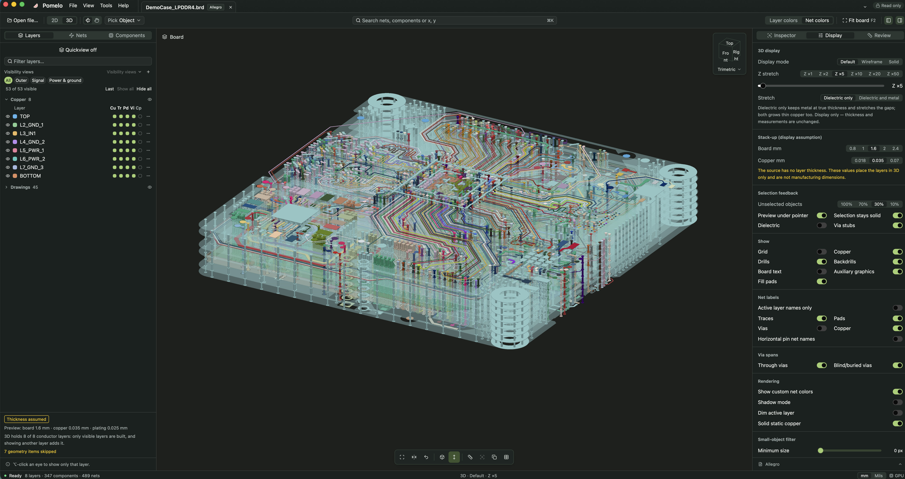
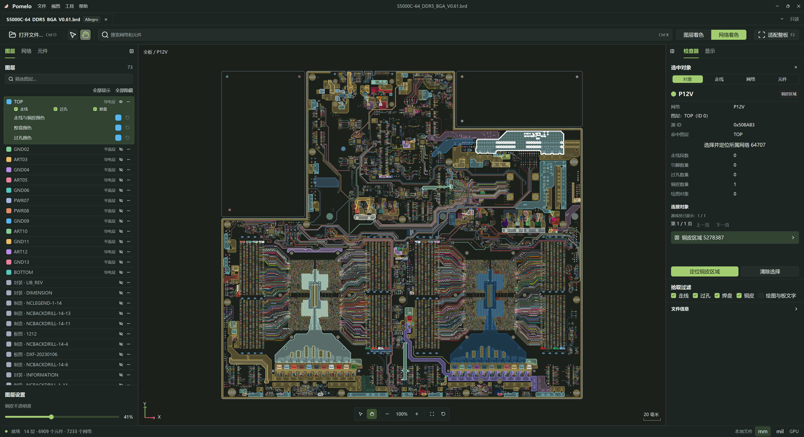

<p align="center">
  
</p>

<h1 align="center">Pomelo Desktop</h1>

<p align="center">
  <strong>打开任何一块 PCB，2D 和 3D 逐层看清。</strong><br>
  面向 Layout 工程师与 SI/PI 工程师的免费、开源、高速 PCB 查看器。<br>
  用 Rust 原生读取 Allegro、Altium、ODB++、PADS、KiCad 和 HFSS EDB 文件——无需厂商软件，无需上传。
</p>

<p align="center">
  <a href="https://github.com/HaiwenZhang/Pomelo-Desktop/releases/latest"></a>
  <a href="https://github.com/HaiwenZhang/Pomelo-Desktop/actions/workflows/ci.yml"></a>
  
  
  <a href="LICENSE"></a>
</p>

<p align="center"><a href="README.md">English</a> · 简体中文 · <a href="README_zh-TW.md">繁體中文</a> · <a href="README_ja.md">日本語</a> · <a href="README_ko.md">한국어</a></p>



<p align="center"><a href="https://github.com/HaiwenZhang/Pomelo-Desktop/releases/latest"><b>⬇ 下载 Windows、macOS、Linux 版本</b></a> · <a href="#从源码构建">从源码构建</a> · <a href="#你可以做什么">功能一览</a></p>

## 为什么是 Pomelo

同事、供应商或老项目发来一个板子文件，你只是想**看一看**：追一条网络、查一个过孔、看看 BGA 底下走了什么。通常这意味着装一套庞大的 EDA 软件、找许可证，或者把设计传到别人的云上。

Pomelo 直接在你的电脑上打开文件，并用 GPU 绘制。

- **原生解析，不依赖厂商软件。** 所有导入器都用 Rust 编写，不调用 Cadence、Altium 或 Ansys 的软件，也不需要 JavaScript 引擎。
- **设计文件留在本地。** 文件不会离开你的电脑，Pomelo 也从不写回源文件。
- **真实大板也流畅。** 走线、圆弧、焊盘、带孔铜皮和板上文字通过同一套 WGSL 着色器，在 D3D11、Metal 或 Vulkan 上原生渲染。百万级对象的电路板依然可以流畅交互。
- **2D 与 3D 同一个窗口。** 一键切换，位置、选择和图层设置都保持不变。

## 你可以做什么

### 在 2D 中审阅版图

- **快速定位**：搜索网络和元件，或输入 `x, y` 直接跳到坐标。
- **掌控每一层**：每个导体层一行矩阵，铜皮、走线、焊盘、过孔、元件各自可填充、线框或隐藏；逐层不透明度；保存可见性视图；单层模式配合 PageUp/PageDown 逐层切换。
- **测量**：两点距离、折线、对象净距，以及沿走线和过孔的引脚到引脚路径长度。
- **读懂一个网络**：检查器卡片里一次看到各层走线长度、每个过孔实际连接了哪些层、过孔残桩、上下最近的参考平面和所有引脚。
- **比较长度**：网络长度表把选中网络与它的差分对或总线并排比较，带各层长度和差值，可复制为 CSV。
- **看清下方有什么**：指针处叠层列出光标下每个导体层的内容；相邻平面叠显把走线上下的参考平面叠在一起看。
- **分享结论**：高亮组、命名视图、视图历史、PNG/SVG 导出和复制到剪贴板。

### 在 3D 中查看层叠

- **三种显示模式**：默认（按各层不透明度）、线框（看穿内部）、实体。
- **按需拉伸 Z 轴**：只拉开介质层间距、铜厚保持真实，或者整体拉伸；只影响显示，读数不变。
- **像 CAD 一样操作**：视图立方体与九个标准方向，以鼠标所在点为中心旋转，右键/中键拖动平移，在鼠标处缩放。
- **聚焦一个信号**：隔离网络或元件及其经过的层，未选对象自动淡化，过孔残桩单独标出。
- **3D 测量**：吸附焊盘中心、过孔中心、线端点和层表面，给出 ΔX、ΔY、ΔZ。
- **应对大型设计**：3D 只为显示的层生成网格，打开新层时自动补上；内存不够时降低细节而不是直接失败，并告诉你简化了什么。



### 日常好用

- 多文档标签页、带缩略图的最近文件，重新打开时恢复每块板的查看状态。
- 简体中文、繁體中文、English、日本語、한국어 界面；浅色与深色主题。
- 推断出的分组（差分对、总线、电源与地）和假设的层叠厚度都会明确标注——Pomelo 展示事实与假设，不做 DRC 判断。

## 支持的格式

| 工具 | 文件 |
| --- | --- |
| Cadence Allegro | `.brd`、`.mcm` |
| Altium Designer | `.PcbDoc` |
| ODB++ | `.tgz`、`.tar`、`.tar.gz` |
| PADS | `.pcb` |
| KiCad | `.kicad_pcb` |
| Ansys HFSS 3D Layout / EDB | `edb.def` |

导入范围取决于文件版本和其中保存的数据。暂不支持的内容会列在诊断面板里，而不是悄悄丢弃——欢迎[提交 Issue](https://github.com/HaiwenZhang/Pomelo-Desktop/issues) 并附上诊断信息。

## 安装

从 [Releases](https://github.com/HaiwenZhang/Pomelo-Desktop/releases/latest) 下载对应平台的安装包：

| 平台 | 安装包 |
| --- | --- |
| Windows 10/11（x64、ARM64） | `.exe` 安装程序 |
| macOS 14+（Apple 芯片、Intel） | `.dmg` 或 `.app.zip` |
| Ubuntu 24.04+（amd64、arm64） | `.deb` 或 `.tar.gz` |

macOS 版本为 ad-hoc 签名：首次打开时请右键点击应用，选择“打开”。

用 **Ctrl+O**（macOS 为 ⌘O）、拖放到窗口或命令行打开电路板：

```sh
pomelo --locale zh-CN --encoding auto "board.brd"
```

`--locale` 支持 `en`、`zh-CN`、`zh-TW`、`ja`、`ko`，只对本次启动生效。`--encoding`（`auto`、`utf-8`、`gbk`、`shift_jis`、`big5`、`windows-1252`）用于解决旧文件中名称解码不正确的问题。`--` 之后的参数作为文件路径。

## 快捷键

| 操作 | 按键 |
| --- | --- |
| 打开 / 关闭 / 重新加载 | `Ctrl+O` / `Ctrl+W` / `Ctrl+R` |
| 搜索，或跳转到 `x, y` | `Ctrl+K` |
| 适配整板 | `F2` |
| 翻转电路板 | `B` |
| 单层模式 / 切换活动层 | `L` / `PageUp` `PageDown` |
| 测量距离 / 折线 / 净距 | `M` / `P` / `C` |
| 引脚到引脚路径长度 | `Shift+L` |
| 框选 / 框选放大 | `S` / `Z` |
| 下一个重叠对象 | `N`（2D）、再次单击（3D） |
| 视图历史后退 / 前进 | `Alt+←` / `Alt+→` |
| 切换左侧 / 右侧面板 | `Ctrl+B` / `Ctrl+Shift+B` |
| 3D：旋转 / 平移 / 缩放 | 左键拖动 / 右键或中键拖动 / 滚轮 |

macOS 上用 ⌘ 代替 Ctrl。

## 从源码构建

需要 Git 和仓库固定的 Rust **1.98.1** 工具链（`rustup` 会自动安装）。

| 平台 | 另需 |
| --- | --- |
| Windows | MSVC C++ 构建工具、Windows SDK、支持 Direct3D 11 的显卡 |
| macOS | Xcode Command Line Tools、支持 Metal 的 Mac |
| Linux | fontconfig、FreeType、xkbcommon、Wayland/X11、ALSA、OpenSSL 开发包，以及 Vulkan 驱动 |

```sh
git clone https://github.com/HaiwenZhang/Pomelo-Desktop.git
cd Pomelo-Desktop
cargo run -p pomelo --release --locked
```

CI 使用的检查：

```sh
cargo fmt --all -- --check
cargo clippy --workspace --all-targets --locked -- -D warnings
cargo test --workspace --locked
```

`cargo run -p pomelo-import --bin pcb_inspect --locked -- --help` 可在命令行检查文件。

<details>
<summary>发布打包</summary>

| 平台 | 安装包 | 命令 |
| --- | --- | --- |
| Windows x64 / ARM64 | `.exe` | `scripts\build-windows.bat`（`--arch arm64`） |
| macOS arm64 / x64 | `.dmg`、`.app.zip` | `scripts/build-macos.sh` |
| Ubuntu 24.04+ amd64 / arm64 | `.deb`、`.tar.gz` | `scripts/build-ubuntu.sh` |

macOS 打包需要 ImageMagick，Windows 需要 Inno Setup 6，Ubuntu 需要 `dpkg-dev` 和 `desktop-file-utils`。产物输出到 `dist`。脚本支持 `--offline`、`--toolchain NAME`、`--output-dir PATH` 和 `--binary PATH`。macOS 默认 ad-hoc 签名（`MACOS_SIGNING_IDENTITY` 选择钥匙串中的签名身份），最低支持 macOS 14.0。Ubuntu 发布版在 24.04 上构建以保持其 ABI 基线。

推送与工作区版本一致的 `vX.Y.Z` 标签会触发[发布流程](.github/workflows/release.yml)，构建全部平台并发布安装包和 `SHA256SUMS`。

</details>

## 工作原理

| Crate | 作用 |
| --- | --- |
| [pomelo-import](crates/pomelo-import) | 各格式的原生 Rust 解析器与结构化诊断 |
| [pomelo-core](crates/pomelo-core) | 电路板模型、搜索、选择、网络分析、审阅工具与多语言 |
| [pomelo-render](crates/pomelo-render) | 2D 与 3D 场景准备；基于同一套 WGSL 着色器的 D3D11、Metal、wgpu 渲染器（naga 转换为 HLSL 和 MSL） |
| [pomelo](crates/pomelo) | 基于 [GPUI](https://github.com/zed-industries/zed/tree/main/crates/gpui) 与 [GPUI Kit](https://github.com/longbridge/gpui-kit) 的桌面应用 |

设计文档见 [docs](docs/README.md)，包括 [2D/3D 统一查看界面计划](docs/viewer-2d-3d-unified-ui-plan.md)、[3D 渲染设计](docs/pcb-3d-rendering-design.md)和 [GPU 后端](docs/native-gpu-backends.md)。

## 状态与路线图

Pomelo 正在积极开发中。格式兼容性、显示精度和各平台稳定性仍在验证，依赖某个读数之前请与源工具核对。

接下来：

- 读取源文件中的真实层叠厚度与材料，支持多区域层叠
- 3D 剖切平面与截面
- 2D/3D 联动分屏
- 按封装高度和 3D 模型显示元件
- 对单层就特别大的电路板，按区域加载 3D

Pomelo 始终是查看器：不编辑设计、不布线、不做 DRC。

## 参与贡献

每多一个能顺利打开的板子文件，所有人都受益。可以从这些方面开始：

- **格式兼容**：[提交 Issue](https://github.com/HaiwenZhang/Pomelo-Desktop/issues)，写明源工具及版本、操作系统和显卡、预期结果，并附上导入诊断。小样例或源工具截图很有帮助；分享前请移除保密数据。
- **渲染与性能**：视觉改动请附前后对比截图，大板改动请附耗时数据。
- **翻译**：界面文字都在 [locales](locales)；五个 README 保持同步。

解析和几何相关的改动需要配套的回归测试。参见[开发进展](docs/development-progress.md)和[验证方法](docs/validation-guide.md)。

如果 Pomelo 让你不必为了看一眼板子而安装整套 EDA 软件，**点个 ⭐ 能帮更多人找到它。**

## 许可证

Copyright (c) 2026 HaiwenZhang。项目代码采用 [Apache License 2.0](LICENSE) 许可。随附字体保留各自的许可证，见 [Source Han Sans](assets/fonts/source-han-sans/README.md)。

## 致谢

基于 [GPUI](https://github.com/zed-industries/zed/tree/main/crates/gpui) 与 [GPUI Kit](https://github.com/longbridge/gpui-kit) 构建。
