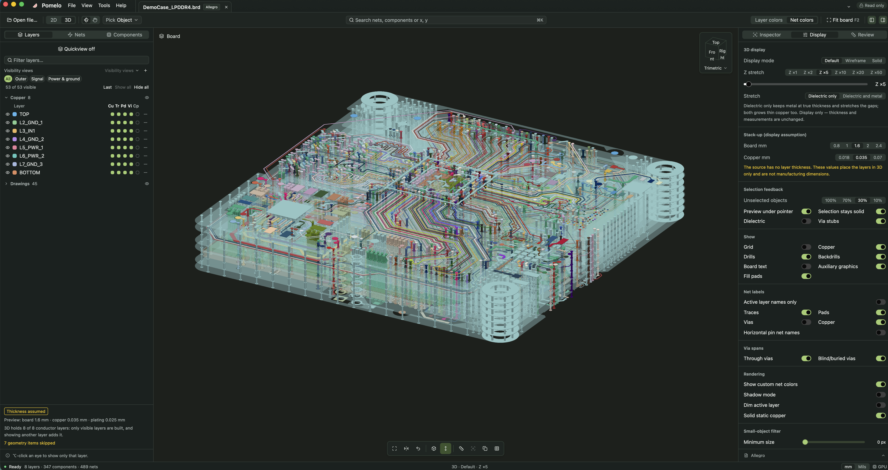
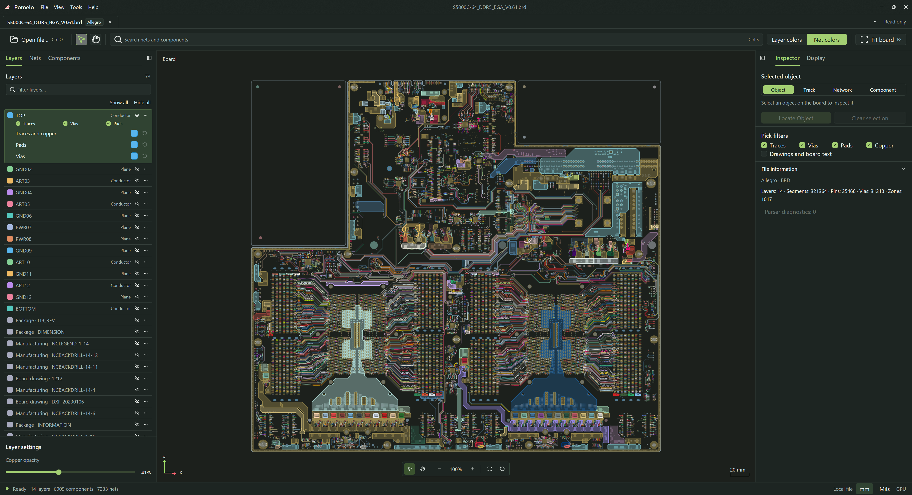

<p align="center">
  
</p>

<h1 align="center">Pomelo Desktop</h1>

<p align="center">
  <strong>打開任何一塊 PCB，2D 與 3D 逐層看清。</strong><br>
  為 Layout 工程師與 SI/PI 工程師打造的免費、開源、高速 PCB 檢視器。<br>
  以 Rust 原生讀取 Allegro、Altium、ODB++、PADS、KiCad 與 HFSS EDB 檔案——不需廠商軟體，也不必上傳。
</p>

<p align="center">
  <a href="https://github.com/HaiwenZhang/Pomelo-Desktop/releases/latest"></a>
  <a href="https://github.com/HaiwenZhang/Pomelo-Desktop/actions/workflows/ci.yml"></a>
  
  
  <a href="LICENSE"></a>
</p>

<p align="center"><a href="README.md">English</a> · <a href="README_zh-CN.md">简体中文</a> · 繁體中文 · <a href="README_ja.md">日本語</a> · <a href="README_ko.md">한국어</a></p>



<p align="center"><a href="https://github.com/HaiwenZhang/Pomelo-Desktop/releases/latest"><b>⬇ 下載 Windows、macOS、Linux 版本</b></a> · <a href="#從原始碼建置">從原始碼建置</a> · <a href="#你可以做什麼">功能一覽</a></p>

## 為什麼是 Pomelo

同事、供應商或舊專案傳來一個電路板檔案，你只是想**看一看**：追一條網路、查一個導通孔、看看 BGA 底下走了什麼。通常這代表要安裝一整套 EDA 軟體、找授權，或把設計上傳到別人的雲端。

Pomelo 直接在你的電腦上開啟檔案，並以 GPU 繪製。

- **原生解析，不依賴廠商軟體。** 所有匯入器都以 Rust 撰寫，不呼叫 Cadence、Altium 或 Ansys 的軟體，也不需要 JavaScript 引擎。
- **設計檔留在本機。** 檔案不會離開你的電腦，Pomelo 也從不寫回原始檔案。
- **真實大板依然流暢。** 走線、圓弧、焊墊、帶孔銅皮與板上文字透過同一套 WGSL 著色器，在 D3D11、Metal 或 Vulkan 上原生繪製。上百萬個物件的電路板仍可流暢操作。
- **2D 與 3D 在同一個視窗。** 一鍵切換，位置、選取與圖層設定都保持不變。

## 你可以做什麼

### 在 2D 中審閱佈局

- **快速定位**：搜尋網路與元件，或輸入 `x, y` 直接跳到座標。
- **掌控每一層**：每個導體層一列矩陣，銅皮、走線、焊墊、導通孔、元件各自可填充、線框或隱藏；逐層不透明度；儲存可見性檢視；單層模式搭配 PageUp/PageDown 逐層切換。
- **量測**：兩點距離、折線、物件淨距，以及沿走線與導通孔的接腳到接腳路徑長度。
- **讀懂一條網路**：檢查器卡片一次呈現各層走線長度、每個導通孔實際連接哪些層、導通孔殘段、上下最近的參考平面與所有接腳。
- **比較長度**：網路長度表把選取的網路與其差動對或匯流排並排比較，附各層長度與差值，可複製為 CSV。
- **看清下方有什麼**：指標處疊構列出游標下每個導體層的內容；相鄰平面疊顯把走線上下的參考平面疊在一起看。
- **分享結論**：醒目提示群組、命名檢視、檢視歷程、PNG/SVG 匯出與複製到剪貼簿。

### 在 3D 中檢視疊構

- **三種顯示模式**：預設（依各層不透明度）、線框（看穿內部）、實體。
- **依需求拉伸 Z 軸**：只拉開介質層間距、銅厚維持真實，或整體拉伸；只影響顯示，讀數不變。
- **像 CAD 一樣操作**：檢視立方體與九個標準方向，以滑鼠所在點為中心旋轉，右鍵/中鍵拖曳平移，在滑鼠處縮放。
- **聚焦一個訊號**：隔離網路或元件及其經過的層，未選物件自動淡化，導通孔殘段另外標示。
- **3D 量測**：吸附焊墊中心、導通孔中心、線端點與層表面，提供 ΔX、ΔY、ΔZ。
- **應付大型設計**：3D 只為顯示中的層產生網格，開啟新層時自動補上；記憶體不足時降低細節而不是直接失敗，並說明簡化了什麼。



### 日常好用

- 多文件分頁、附縮圖的最近檔案，重新開啟時還原每塊板的檢視狀態。
- 繁體中文、简体中文、English、日本語、한국어 介面；淺色與深色主題。
- 推斷出的分組（差動對、匯流排、電源與地）與假設的疊構厚度都會明確標示——Pomelo 呈現事實與假設，不做 DRC 判斷。

## 支援的格式

| 工具 | 檔案 |
| --- | --- |
| Cadence Allegro | `.brd`、`.mcm` |
| Altium Designer | `.PcbDoc` |
| ODB++ | `.tgz`、`.tar`、`.tar.gz` |
| PADS | `.pcb` |
| KiCad | `.kicad_pcb` |
| Ansys HFSS 3D Layout / EDB | `edb.def` |

匯入範圍取決於檔案版本與其中儲存的資料。尚未支援的內容會列在診斷面板中，而不是悄悄略過——歡迎[提交 Issue](https://github.com/HaiwenZhang/Pomelo-Desktop/issues) 並附上診斷資訊。

## 安裝

從 [Releases](https://github.com/HaiwenZhang/Pomelo-Desktop/releases/latest) 下載對應平台的安裝套件：

| 平台 | 套件 |
| --- | --- |
| Windows 10/11（x64、ARM64） | `.exe` 安裝程式 |
| macOS 14+（Apple 晶片、Intel） | `.dmg` 或 `.app.zip` |
| Ubuntu 24.04+（amd64、arm64） | `.deb` 或 `.tar.gz` |

macOS 版本為 ad-hoc 簽署：第一次開啟時請以右鍵點選應用程式，選擇「打開」。

以 **Ctrl+O**（macOS 為 ⌘O）、拖放到視窗或命令列開啟電路板：

```sh
pomelo --locale zh-TW --encoding auto "board.brd"
```

`--locale` 支援 `en`、`zh-CN`、`zh-TW`、`ja`、`ko`，只對本次啟動有效。`--encoding`（`auto`、`utf-8`、`gbk`、`shift_jis`、`big5`、`windows-1252`）可解決舊檔案名稱解碼錯誤的問題。`--` 之後的參數視為檔案路徑。

## 快速鍵

| 操作 | 按鍵 |
| --- | --- |
| 開啟 / 關閉 / 重新載入 | `Ctrl+O` / `Ctrl+W` / `Ctrl+R` |
| 搜尋，或跳到 `x, y` | `Ctrl+K` |
| 適配整板 | `F2` |
| 翻轉電路板 | `B` |
| 單層模式 / 切換作用層 | `L` / `PageUp` `PageDown` |
| 量測距離 / 折線 / 淨距 | `M` / `P` / `C` |
| 接腳到接腳路徑長度 | `Shift+L` |
| 框選 / 框選放大 | `S` / `Z` |
| 下一個重疊物件 | `N`（2D）、再次點擊（3D） |
| 檢視歷程上一步 / 下一步 | `Alt+←` / `Alt+→` |
| 切換左側 / 右側面板 | `Ctrl+B` / `Ctrl+Shift+B` |
| 3D：旋轉 / 平移 / 縮放 | 左鍵拖曳 / 右鍵或中鍵拖曳 / 滾輪 |

在 macOS 上以 ⌘ 取代 Ctrl。

## 從原始碼建置

需要 Git 與儲存庫固定的 Rust **1.98.1** 工具鏈（`rustup` 會自動安裝）。

| 平台 | 另需 |
| --- | --- |
| Windows | MSVC C++ 建置工具、Windows SDK、支援 Direct3D 11 的顯示卡 |
| macOS | Xcode Command Line Tools、支援 Metal 的 Mac |
| Linux | fontconfig、FreeType、xkbcommon、Wayland/X11、ALSA、OpenSSL 開發套件，以及 Vulkan 驅動程式 |

```sh
git clone https://github.com/HaiwenZhang/Pomelo-Desktop.git
cd Pomelo-Desktop
cargo run -p pomelo --release --locked
```

CI 使用的檢查：

```sh
cargo fmt --all -- --check
cargo clippy --workspace --all-targets --locked -- -D warnings
cargo test --workspace --locked
```

`cargo run -p pomelo-import --bin pcb_inspect --locked -- --help` 可在命令列檢查檔案。

<details>
<summary>發佈打包</summary>

| 平台 | 套件 | 命令 |
| --- | --- | --- |
| Windows x64 / ARM64 | `.exe` | `scripts\build-windows.bat`（`--arch arm64`） |
| macOS arm64 / x64 | `.dmg`、`.app.zip` | `scripts/build-macos.sh` |
| Ubuntu 24.04+ amd64 / arm64 | `.deb`、`.tar.gz` | `scripts/build-ubuntu.sh` |

macOS 打包需要 ImageMagick，Windows 需要 Inno Setup 6，Ubuntu 需要 `dpkg-dev` 與 `desktop-file-utils`。產物輸出到 `dist`。腳本支援 `--offline`、`--toolchain NAME`、`--output-dir PATH` 與 `--binary PATH`。macOS 預設 ad-hoc 簽署（`MACOS_SIGNING_IDENTITY` 指定鑰匙圈中的簽署身分），最低支援 macOS 14.0。Ubuntu 發佈版在 24.04 上建置以維持其 ABI 基準。

推送與工作區版本一致的 `vX.Y.Z` 標籤會觸發[發佈流程](.github/workflows/release.yml)，建置所有平台並發佈套件與 `SHA256SUMS`。

</details>

## 運作方式

| Crate | 作用 |
| --- | --- |
| [pomelo-import](crates/pomelo-import) | 各格式的原生 Rust 解析器與結構化診斷 |
| [pomelo-core](crates/pomelo-core) | 電路板模型、搜尋、選取、網路分析、審閱工具與多語系 |
| [pomelo-render](crates/pomelo-render) | 2D 與 3D 場景準備；以同一套 WGSL 著色器實作的 D3D11、Metal、wgpu 繪製器（naga 轉換為 HLSL 與 MSL） |
| [pomelo](crates/pomelo) | 以 [GPUI](https://github.com/zed-industries/zed/tree/main/crates/gpui) 與 [GPUI Kit](https://github.com/longbridge/gpui-kit) 建構的桌面應用程式 |

設計文件見 [docs](docs/README.md)，包含 [2D/3D 統一檢視計畫](docs/viewer-2d-3d-unified-ui-plan.md)、[3D 繪製設計](docs/pcb-3d-rendering-design.md)與 [GPU 後端](docs/native-gpu-backends.md)。

## 狀態與路線圖

Pomelo 正在積極開發中。格式相容性、顯示精度與各平台穩定性仍在驗證，依賴任何讀數之前請與原始工具核對。

接下來：

- 讀取原始檔案中的真實疊構厚度與材料，支援多區域疊構
- 3D 剖切平面與截面
- 2D/3D 連動分割畫面
- 依封裝高度與 3D 模型顯示元件
- 對單層就特別大的電路板，依區域載入 3D

Pomelo 始終是檢視器：不編輯設計、不佈線、不做 DRC。

## 參與貢獻

每多一個能順利開啟的電路板檔案，所有人都受益。可以從這些地方開始：

- **格式相容**：[提交 Issue](https://github.com/HaiwenZhang/Pomelo-Desktop/issues)，寫明原始工具與版本、作業系統與顯示卡、預期結果，並附上匯入診斷。小樣本或原始工具截圖很有幫助；分享前請移除機密資料。
- **繪製與效能**：視覺改動請附前後對照截圖，大板改動請附耗時數據。
- **翻譯**：介面文字都在 [locales](locales)；五個 README 保持同步。

解析與幾何相關的改動需要附上對應的回歸測試。請參考[開發進展](docs/development-progress.md)與[驗證方法](docs/validation-guide.md)。

如果 Pomelo 讓你不必為了看一眼電路板而安裝整套 EDA 軟體，**按個 ⭐ 能幫更多人找到它。**

## 授權

Copyright (c) 2026 HaiwenZhang。專案程式碼採用 [Apache License 2.0](LICENSE) 授權。隨附字型保留各自的授權，見 [Source Han Sans](assets/fonts/source-han-sans/README.md)。

## 致謝

以 [GPUI](https://github.com/zed-industries/zed/tree/main/crates/gpui) 與 [GPUI Kit](https://github.com/longbridge/gpui-kit) 建構。
