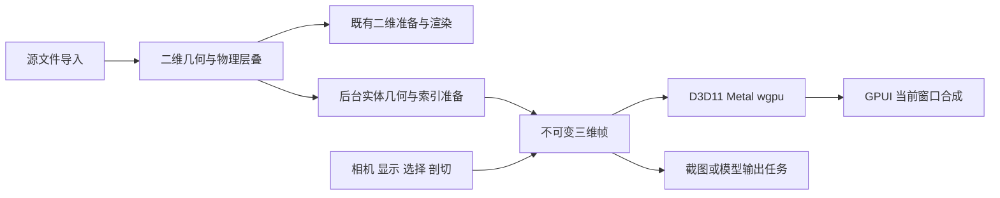

# PCB 三维显示开发设计

日期：2026-10-18。源码基线：`e87011bbdf1df2505d48457823fe02479b21d668`。本文是开发方案，**没有实现或验收三维功能**。功能编号、Ansys 行为证据和未知项见 [HFSS 3D Layout 三维显示调研](hfss3d-layout-3d-rendering-reference.md)。

## 1. 目标、阶段和约束

目标是让 Pomelo 在现有只读 PCB 查看器中提供可旋转的真实层叠、内部结构检查、显示过滤、选择和输出。第一阶段完成平板层叠的工程三维查看；后续接入元件实体、多区域、外部网格和场结果。

本文采用项目既有的四个 crate 与原生 GPU 路线。保留二维查看及其精确解析曲线；三维使用独立准备数据和渲染管线。继续复用 GPUI 窗口设备与统一呈现，不引入独立交换链、浏览器三维视口或运行时 Ansys 依赖。架构依据见 [GPU 绘制设计](cad-gpu-painter-design.md)、[原生后端](native-gpu-backends.md)和 [ADR 0001](adr/0001-native-gpu-rendering.md)。

只读显示设置保存到 Pomelo 偏好，不写回 PCB。CAD 几何核、真实弯折、场数据读取属于单独扩展；没有数据时保持明确的缺失状态，不能用看似真实的默认厚度、孔壁或封装替代。

## 2. 现有能力与差距（源码核对）

以下“已有”指代码中存在该基础，不表示本次重新执行了 GPU 或完整文件验收。

| 现有入口 | 可复用基础 | 三维差距 |
| --- | --- | --- |
| [`model/mod.rs`](../crates/pomelo-core/src/model/mod.rs) | Point、LayerId、ObjectId、网络、圆弧线段、逐层 Pad、DrillShape、Via 层跨度、背钻、ComponentPlacement、outline | Point/Bounds 为二维；Layer 无厚度/高度/材料；ComponentPlacement 无实体外形、Z 或模型资产 |
| [`interaction/mod.rs`](../crates/pomelo-core/src/interaction/mod.rs) | Camera 的中心、pixels_per_mm、flipped，二维导航 | 无三维位置、姿态、旋转中心及投影矩阵 |
| [`display.rs`](../crates/pomelo-core/src/display.rs)、[`appearance.rs`](../crates/pomelo-core/src/appearance.rs) | 图层隐藏、类别开关、层序、Layer/Net 着色、颜色覆盖、透明度和标签 | 不能把二维 layer_order 当作物理高度；缺介质/封装类别、网络可见集合和三维模式规则 |
| [`geometry/copper.rs`](../crates/pomelo-core/src/geometry/copper.rs) | 轮廓、孔环、曲线和有预算的铜覆盖网格 | 现有 CopperMesh 以外轮廓覆盖减孔洞覆盖合成，不是可直接拉伸的封闭实体网格 |
| [`interaction/picking_index.rs`](../crates/pomelo-core/src/interaction/picking_index.rs)、[`selection.rs`](../crates/pomelo-core/src/interaction/selection.rs) | 二维索引、类型化选择、网络/元件归属、候选及成员 | 三维需要射线、深度、可见剖切和实体表面身份 |
| [`formats/`](../crates/pomelo-import/src/formats/README.md) | 各格式原生导入、归一单位、已保存铜、轮廓、诊断和取消 | 现有共享输出没有完整物理层叠；源格式有字段不表示已经保留到领域场景 |
| [`formats/hfss/mod.rs`](../crates/pomelo-import/src/formats/hfss/mod.rs) | HFSS/EDB 几何导入入口 | 当前公开模型输出只建立信号层等二维数据，不能据“支持 HFSS”推断支持其完整三维数据 |
| [`document/preparation.rs`](../crates/pomelo/src/document/preparation.rs) | 后台导入、预算、取消、搜索/拾取准备和查看状态恢复 | 增加可按需启动的三维准备阶段及独立失败状态 |
| [`scene/`](../crates/pomelo-render/src/scene/mod.rs) | 图元准备、资源版本、曲线缓存和内存控制 | 新增实体网格、法线、边、实例、空间索引和三维 bounds |
| [`backend/common/`](../crates/pomelo-render/src/backend/common/mod.rs) | NativeGpuRenderer、帧借用设备、平台资源封装 | 现有公共 Draw 以二维/模板覆盖为中心，需三维附件、深度和多遍接口 |
| [`backend/d3d11/driver.rs`](../crates/pomelo-render/src/backend/d3d11/driver.rs) | GPU 缓冲、模板附件与绘制资源 | 当前对应绘制状态关闭深度测试/写入；有 DepthStencil 类型不代表已有实体遮挡 |
| [`shaders/d3d11/trace.hlsl`](../crates/pomelo-render/src/shaders/d3d11/trace.hlsl) | 精确二维曲线与坐标补偿 | 当前顶点投影 z=0，不是三维实体顶点变换 |
| [`viewport/`](../crates/pomelo/src/viewport/mod.rs) | BoardViewport 为状态所有者；帧、导航、拾取、显示面板已拆分 | 增加三维状态分支，避免把第二个独立会话塞入面板 |
| [`view_state.rs`](../crates/pomelo-core/src/view_state.rs)、[`preferences/view_state.rs`](../crates/pomelo/src/services/preferences/view_state.rs) | schema=1、来源身份核对、严格反序列化与原子保存基础 | 三维相机和显示预设需要正式迁移，不能只加字段并期望旧文件自动兼容 |

与 [审阅功能设计](viewer-review-development-design.md)共享测量、选择集合、命名视图和输出服务的边界，避免再建一套相同业务。

## 3. 建议架构与文件落点

下表“新增”路径均为建议，当前不存在，实施到对应阶段时再创建。现有模块文件名保持其职责，不为了三维批量重命名二维模块。

| 层次 | 新增或扩展落点 | 输入 → 输出 | 状态所有者 |
| --- | --- | --- | --- |
| 物理模型 | 新增 `pomelo-core/src/model/stackup.rs`、`geometry3d.rs` | 归一层叠/轮廓/孔跨度 → 物理结构契约 | BoardScene 的只读物理扩展 |
| 三维导航 | 新增 `pomelo-core/src/interaction/camera3d.rs` | 导航命令、视口尺寸 → Camera3d | BoardViewport |
| 显示策略 | 新增 `pomelo-core/src/display3d.rs` | 基础显示、三维覆盖、选择 → 可见性/材料快照 | 每文档 View3dState |
| 导入 | 扩展 `pomelo-import/src/formats/` 与 `scene_builder.rs` | 各格式受支持的物理数据 → 统一结构及诊断 | 导入后台任务 |
| 网格准备 | 新增 `pomelo-render/src/scene/solid/` | 物理模型、曲线容差、预算 → PreparedBoard3d | 后台准备任务 |
| 三维渲染 | 新增 `pomelo-render/src/backend/solid_renderer.rs`、`backend/common/solid.rs` | 不可变 Board3dFrame → 平台绘制命令 | 窗口 GPU renderer |
| 平台资源 | 扩展 D3D11/Metal/wgpu 各自 driver、shaders | 公共三维绘制语义 → 本机资源/编码 | 当前设备资源代次 |
| 着色器 | 新增各平台 `solid`、`solid_edge`、`solid_composite` 着色器 | 顶点/实例/帧 → 颜色、深度、边及合成 | pomelo-render |
| 应用接线 | 新增 `viewport/view3d.rs`，扩展 frame/navigation/gesture/picking | 工具动作 → 核心命令及帧 | BoardViewport，不由面板另存相机 |
| 面板 | 组合现有 layers/display/inspector，必要时新增 `panels/stackup.rs` | 只读展示模型、命令回调 | 面板仅有焦点、滚动、输入暂存 |
| 保存与输出 | 扩展现有偏好服务；新增导出服务 | 版本化快照 → 偏好或用户选择路径的文件 | 后台服务 |



## 4. 数据契约：先补真实结构

### 4.1 物理层叠

建议给 BoardScene 增加可选的 `PhysicalBoard`，保留现有 LayerId 的二维身份。物理层通过 LayerId 关联，而不是重新按列表位置编号。

| 契约 | 建议字段与不变量 |
| --- | --- |
| PhysicalBoard | stackup 类型、物理层、板域、材料、区域、模型来源和能力报告；可缺失 |
| PhysicalLayer | layer_id、region_id、lower_z_mm、thickness_mm、material_id；upper=lower+thickness；显式记录零厚度层语义 |
| StackupRegion | 稳定区域身份、带孔区域轮廓、该区域有效层叠；现有同名轻量引用只含来源/code，不能视为已有完整区域 |
| BoardDomain | 闭合板边界、内开槽、岛；不以整个 scene.bounds 矩形代替板形 |
| Material | 来源名称、工程类别及显示颜色；电磁材料参数与视觉参数分离 |
| DrillSpan3d | 对象身份、实际 Z 起止、孔截面、镀层状态、可选镀层厚度、背钻段；未知跨度不自动贯通 |
| ComponentBody | component_id、安装面、放置变换、包络或外部模型引用、真实高度、外形质量等级 |
| Quality/Provenance | source、explicit-user-preview、inferred、missing、unsupported 等来源；实体/示意/缺失分开 |

统一采用右手坐标和毫米：XY 延续已有板坐标，+Z 指向板顶。顶层/底层标签和源格式层序通过导入适配为该坐标。CPU 用 f64；GPU 用相对渲染原点的 f32 或经过验证的高低位拆分，防止大坐标板细节抖动。

不能由 LayerId、UI 排序或两层铜之间的序号推断距离。Laminate 可在有厚度和有序层叠时累计高度；Overlapping 必须保留显式高度，不能套用累计算法。空气层或显式零厚度层保留来源，不给未知层填零制造“已知”。

### 4.2 导入与缺失数据策略

1. 各读取器先建立“能提供哪些物理字段”的能力表，再输出统一契约；不在 UI 判断源格式字符串来猜厚度。
2. 扩展 HFSS 入口只处理经样本证实的层叠数据；现有单 cell、未加密等支持边界继续保留，未知扩展返回明确诊断。本文不记录专有二进制字段布局。
3. 板轮廓闭合检查先于实体准备。若开放线段不能确定板域，显示已有二维边，不把铜的包围盒当板材。
4. 缺物理层叠时仍可二维查看。可提供用户明确启用的“示意层间距”预览，但要标注“示意”；禁止用其输出真实孔深、板厚和物理 CAD。
5. 缺封装外形或高度时保留元件定位符；有足够包络和高度才生成简化实体。简化实体必须能追溯质量等级。
6. 错误按层/对象定位。三维准备失败不得导致已成功的二维文档被关闭；显示三维不可用原因和回到二维的操作。

建议诊断类别：层叠缺失、层高冲突、开放板轮廓、非法孔跨度、未知镀层厚度、缺元件模型、三维准备预算不足。用户消息加入共享 MessageKey 和五语资源，原始来源详情保留在技术字段。

### 4.3 兼容模型与缓存

旧的共享场景可以没有 PhysicalBoard。几何和资源键包含源摘要、解码身份、物理模型版本、几何容差与模型资产摘要；改变颜色或选择不重建几何。新场景字段需评估已有样本构造器和序列化调用；不把 UI 偏好 schema 与领域场景版本混为一个编号。

## 5. 从二维几何生成实体

### 5.1 通用流程

`解析路径 → 校验轮廓 → 正/负区域求实际覆盖 → 三角化带孔面 → 顶/底/侧面 → 法线/边 → 对象映射 → bounds/BVH`。

已有 CopperMesh 的孔洞是覆盖相减：直接把其所有 indices 放入三维顶面会把孔再次填回去。应从原始 rings/paths 构造真实多边形差集，对孔洞合并、接触和多个岛采用确定的拓扑规则，然后三角化可见区域。现有 `earcut` 可复用在合法多边形上；现有 `clipper2-rust` 位于 import crate，若通用三维准备需要布尔能力，应把受限封装移到核心几何边界或调整依赖，不能让 render 的生产代码反向依赖 import。

布尔库使用整数坐标时，制定明确 mm→整数比例、误差预算与溢出检查。输入/输出保持 source ID 映射；三角形编号和 GPU draw 编号不能替代领域身份。自交、共线重叠、退化小环和失败拓扑需输出诊断；不得仅为了“能画”静默闭孔。

### 5.2 各类结构

| 对象 | 实现方式 | 重点边界 |
| --- | --- | --- |
| 板材/介质 | 板域按各层 Z 区间挤出，开槽和适用钻孔从体积中扣除 | 钻孔只切穿真实跨度，不将盲孔打穿全板；层内填充按数据覆盖 |
| 铜皮/平面 | 有厚度的覆盖区域，顶底面和外环/孔环侧壁 | 负片层先在有限板域内做补集；同层已保存铜不重新铺铜 |
| 走线 | 中心路径按宽度生成二维扫掠区域，再按铜厚挤出 | 保留端帽/连接处；圆弧误差按场景精度控制，避免自交接缝 |
| 焊盘 | 复用 PadKind/CustomPadGeometry 的二维形状，再按实际层高挤出 | 自定义孔、offset、旋转、镜像、donut 与跨层实例 |
| 孔/槽/孔壁 | 真实圆孔或槽截面沿跨度生成内壁；背钻分段处理 | NPTH 无铜壁；未知镀层厚度不能生成可测量的“真实壁厚” |
| 背钻 | 从入口到停止高度去掉对应孔壁/焊盘部分，保留剩余段 | start/stop/protected_layer 映射到物理层，并区别显示直径与制造尺寸 |
| 元件包络 | 来源轮廓按高度挤出，按安装面和放置变换实例化 | 底面用经过定义的安装变换，镜像会影响绕序/法线 |
| 三维组件 | 共享 mesh 资产 + 实例变换 + 材料/选择元数据 | 单位、原点、旋转次序、负行列式变换、层级与缺失资源 |
| 键合线/焊球 | 有真实三维路径/球体参数时生成管状/球状实例 | 现有平面 bond_wire 信息不足以恢复真实弧高；未知时只显示示意并标记 |

不要对所有铜、走线和焊盘做整板全局 CSG。按对象/层/空间块生成并在必要范围处理孔和负片；接触处优先用一致表面规则解决，不以普遍抬高图元制造错误的 Z 距离。

### 5.3 PreparedBoard3d

输出至少包括顶点/法线/索引、材质槽、边索引、分块 bounds、对象到子网格范围、层/网络/元件归属、实例变换、拾取数据、误差与缺失报告。面类别保留 top/bottom/side/hole，用于属性和未来测量。

重复焊盘/孔/封装使用实例和共享网格。批次按不透明性、材料与层/类别组织；显示过滤更新小型 bitset/实例可见性表。不要在每次旋转时重新遍历所有源路径。

## 6. 三维相机、显示变换与导航

### 6.1 相机契约

Camera3d 包含 pivot、单位四元数 orientation、正交视域高度、有效裁剪深度；如以后增加透视，另含 distance、FOV。当前阶段先交付正交观察，透视是 Pomelo 可选扩展，未列为已核实 Ansys 能力。

- 旋转采用可从当前状态中断的 trackball/orbit；不使用会在极点翻转的裸欧拉角累加。
- 平移由相机 right/up 和“毫米/逻辑像素”计算；DPI 只在主机坐标到物理附件处转换。
- 光标锚点缩放使用 pivot 所在观察平面或真实命中点，固定选择策略，避免透明物体造成锚点跳变。
- Fit All/Selection 使用实际显示 AABB 的八角投影，考虑画布比例与留白，不能用二维 XY 范围忽略孔/元件高度。
- 标准方向明确定义相机朝向和 up；Bottom 必须能看到板底，不能只调用现有二维 flipped。
- 零尺寸视口、空选择、极小 bounds、NaN、无效四元数返回可解释结果。near/far 与场景尺寸关联，避免层间深度精度耗尽。

二维和三维相机分别保留。首次从二维进入三维，以二维中心与可见范围推导 pivot/视域并选轴测方向；返回二维不覆盖原二维缩放。导航历史在手势完成时记一条，包含三维方向、pivot、视域和显示变换；设置有界容量和前后栈。

### 6.2 Z 拉伸

保存物理 `z` 与展示 `z'` 的区别：`z' = z_anchor + scale × (z - z_anchor)`，scale 为有限正数。层和孔段端点服从同一变换，倍率变化只更新变换/包围范围，不重建源几何。

非均匀 Z 变换的法线用逆转置变换并归一化。拾取先把世界射线经展示变换逆变换，再与物理几何求交；返回物理点和展示点。测量始终用物理点，不能将拉伸后的孔段作为真实长度。

首期只承诺平板层叠的 Z 拉伸。组件外壳采用“安装点随层移动，实体尺寸不变”的策略，界面说明其作用范围；若追求整个模型非均匀拉伸作为另一模式，需分别验收。刚柔板阶段不能未定义地叠加全局 Z 拉伸和弯折。

## 7. GPU 渲染与平台接入

### 7.1 帧和附件

增加 Board3dFrame，持有 PreparedBoard3d 的 Arc、camera snapshot、display/selection/clip revision、渲染原点、灯光、GPUI bounds/clip/DPI 参数。renderer 使用 NativeGpuRenderer 接口；当前二维 BoardFrame 和 BoardRenderer 不承担三维兼容开关堆积。

建议在同一 GPUI 设备和绘制回调中，使用由 pomelo-render 管理的三维离屏颜色/深度附件，再把颜色作为纹理合成到当前窗口目标。这样三维深度、多遍透明与 GPUI 自身的模板/覆盖不互相污染。这是对现有 driver 的新增能力，不是当前接口已支持的假设；M0 必须验证创建、采样和编码顺序能在三端落地。

离屏附件属于必要辅助资源，不另建 swapchain，不自行 present，不保存跨帧借用的窗口目标。尺寸以物理像素建立，scissor 对应有效 clip；缩放/resize 失效附件，颜色空间和 alpha 必须符合 GPUI 当前目标。若验证可安全直接绑定自有 depth 到借用颜色附件，可作为后续优化，但先保留一种一致的合成语义。

### 7.2 绘制遍次

1. 清空三维离屏颜色与深度；背景和空间网格按定义绘制。
2. 不透明面：深度测试与写入开启；先采用常规 0..1 深度，远端清为 1，比较 LessEqual。矩阵、绕序和背面规则在三端统一。
3. 半透明面：保留不透明深度测试、关闭透明深度写入。简单按块排序只作为明确标注限制的中间验证；多层 PCB 正式透明显示采用加权混合 OIT 或经验证等价方案。
4. 边、轮廓和选中对象叠加：避免画出所有三角剖分对角线；区分物理边与内部网格边，使用屏幕像素宽度与有限深度偏置。
5. 测量、文字、方向轴、剖切手柄：明确深度测试/始终可见策略，不让普通选择高亮无意穿透不透明板材。
6. 合成到 GPUI 当前目标，应用宿主内容裁剪及整体透明度。

加权 OIT 使用 accumulation/revealage 附件及合成；权重针对毫米尺度和深度范围设计，不沿用任意常数。它是近似合成，不能宣称等于精确光学。浮点附件、混合格式与并行输出数量需查询设备支持；若平台缺能力，提供可解释降级和视觉测试，不能静默呈现错误层序。

### 7.3 视觉材料

首期使用可调基础色、环境项和方向漫反射，保证铜与介质可读；这是 Pomelo 的视觉设计选择。源层颜色和用户覆盖继续可用，视觉高光不改变工程材料。PBR、阴影、环境贴图不作为对标首期依赖。

GPU 数据布局使用明确的顶点/实例/帧结构、对齐和布局断言；三个着色语言分别维护。D3D11/Metal 必要 unsafe 仅放平台模块既有允许边界。不要把 CPU 核心几何放进平台 driver。

### 7.4 资源与失效

| 变化 | 应更新 | 不应发生 |
| --- | --- | --- |
| 旋转/平移/缩放 | 相机 uniform、可见块、必要 LOD | 整板解析和上传 |
| 颜色/选择/透明度 | 材料或选择表；opaque/transparent 批次分类变化 | 重建所有顶点 |
| 隐藏层/网络 | 可见 bitset、draw ranges、可拾取快照 | 丢失源对象或重编 LayerId |
| Z 倍率 | 变换、展示 bounds、相关索引查询参数 | 修改物理厚度 |
| 剖切平面 | plane uniform、手柄和拾取裁剪 | CPU 重切全板作为每帧前提 |
| 几何/精度级别 | 有变化的块、索引和版本 | 过期准备结果覆盖新文档 |
| DPI/视口尺寸 | 离屏附件、投影、scissor、文字布局 | 重解析源文件 |
| 设备重建 | 全部设备资源 | 持有旧设备的纹理和窗口目标 |

## 8. 显示规则、选择及剖切

### 8.1 统一显示判定

由核心层生成只读显示快照，渲染、拾取、Fit Selected 和导出共同消费。基础可见条件按层/区域、图元类别、网络和对象显隐取交集。无网络的介质和元件外壳不被错误套用 NetId(0) 的网络过滤。

建议保留 `BoardDisplay` 的二维字段，新增三维覆盖：render mode、物理层样式、show_dielectrics、hole display policy、component bodies、clip planes、Z scale、interaction quality。共享字段的所有者只有一个，不能二维和三维各复制一套相互漂移的图层隐藏表。

规则顺序：可见性 → 全局模式 → 逐层线框覆盖 → 材料颜色/透明度 → 选择强调。Default 使用来源/用户层样式；Sketch 绘边；Solid 默认不透明，但保留逐层线框。I05/I06 选择强调作为临时显示覆盖，不改层设置。源 transparency 百分比转换为 `opacity=1-T/100`，数值范围、线性/非线性颜色与 alpha 约定统一。

“透明”和“隐藏”分开：alpha=0 默认不参与普通最近表面拾取；如果需要选透明对象，提供显式选项。内部对象循环选择可以穿透可见表面，但必须排除隐藏、被剖切移除和类别过滤对象，并在候选提示中说明当前序号/身份。

Show Dielectrics 触发的连续孔显示是独立展示策略：从真实孔跨度与可见层计算展示段，绝不覆盖源 DrillSpan3d。跨区域孔不能简单按全板最上/最下层连接。

### 8.2 拾取和高亮

首期采用 CPU 分块 AABB/BVH 与三角形射线求交，复用源身份与网络/元件关系。悬停查询节流并带相机、显示和文档代次；移动中的旧结果不可覆盖新视图。每帧复制全模型做拾取不可接受。

GPU ID picking 可后续加入，使用整数对象键附件、异步读回和过期检查；不能把透明混合后的颜色反推对象 ID。边选择以投影边段距离和深度为依据；屏幕像素容差随 DPI 转换，不能用固定毫米容差。

扩展可拾取类型区分 ComponentBody、DielectricBody、ClipPlane 等视图对象与既有 SelectedObject；避免伪装成 Via/Zone。一个源对象可有多个网格命中，候选按领域身份去重。Properties 显示物理厚度、Z 跨度、来源和质量等级，只有示意数据时明确标注。

### 8.3 剖切

ClipPlane 保存稳定 ID、物理空间单位法线 n、常数 d、启用状态和手柄状态，统一“保留 `dot(n,p)+d >= 0`”的约定。首期设定有界平面数量，并在 UI 解释限制；不能无界增加 shader uniform。

着色器在同一物理坐标对不透明、透明、边、结果覆盖及 picking 测试平面。若几何已经经 Z 展示变换，使用正确的逆变换位置/平面变换计算，不混用空间。新增平面操作可在 Pomelo 查看状态撤销，不修改源设计。

首期剖切只裁显示，不承诺自动封口。若新增截面填充，单独做 mesh/plane 相交线收集、闭环、孔拓扑和切面三角化；不能跨越铜孔填一个大面，也不能把切面生成当作可靠 CAD 实体布尔结果。

## 9. 界面、持久化与输出

### 9.1 交互组合

主要任务是“观察当前 PCB 层叠并定位内部对象”。BoardViewport 保持相机/显示/工具的所有权，沿用现有文档标签、可调整侧栏和检查器。建议工具栏提供 2D/3D 切换、适应整板、方向、显示模式和剖切；逐层设置放现有层面板，模型来源和缺失原因放检查器/诊断面板。

GPUI Kit 界面要求：命令使用 Button/Action，模式使用有持久选中态的现有选择控件；逐层矩阵使用虚拟化列表或表格；设置用 Checkbox/Slider/Input 的语义组合，倍率和透明度同时可键盘输入。主题、尺寸和间距遵循 [GPUI Kit Design Guides](https://gpui-kit.com/docs/design-guides.md)，不照搬 Ansys 的固定像素工具栏。

进入三维显示“准备中”只对应真实后台任务；失败保留二维和文档上下文。无选择时 Fit Selected 禁用并给原因。Escape 依次取消当前手势/工具预览、关闭顶层弹出并恢复焦点。菜单、上下文和键盘调用同一命令，不把主要功能藏在 hover 按钮中。新增文案进入五种语言，不拼接翻译片段。

建议先保持项目的 F2 适应整板等既有键位；三维旋转/平移/缩放提供显式工具和可配置绑定。Ansys 兼容键位只能作为可选配置，避免 Ctrl+R 等与现有重载冲突。方向切换默认直接完成；若增加过渡，遵守减弱动态效果偏好且可中断。

### 9.2 查看状态迁移

现有 ViewState 拒绝未知字段且验证 schema=1。建议引入显式 V1/V2 解码分派，V2 保留 camera2d 并增加可选 camera3d、active_view、display3d、命名视图和剖切状态。先迁移再校验，不在旧结构上强行反序列化新字段。

V1→V2 保留原二维状态，三维首次进入时初始化；未知新版本返回诊断并保留文件；源身份不匹配时不恢复对象选择/剖切绑定。无效倍率、非有限坐标、非单位四元数和超量 plane/对象集合均拒绝或按明确规则修复。继续使用 JsonFileStore 原子保存和损坏备份机制。

命名“可见性视图”和“完整三维视图”分开契约：前者保存层/网络过滤；后者额外保存相机、Z scale、clip、模式和选定显示字段。恢复不得改变全局语言、主题或文档源数据。

### 9.3 截图和模型输出

截图服务固定一份完整帧快照，先等待该快照必需资源就绪，再渲染到指定尺寸离屏目标并异步读回。输出选项明确是否包含网格、方向轴、测量、标签和选择。高分辨率不通过放大窗口完成；PNG 可复用现有 image 依赖，JPG 需另行启用编码能力。Copy Image 在用户执行时写系统剪贴板。

模型输出与截图分离：可先交付带单位/元数据的网格格式作为 Pomelo 扩展，不能宣称等同 Ansys SAT/Parasolid CAD。真实 STEP/SAT/Parasolid 输出需要几何核、实体拓扑和许可评估；当前三角形网格不能靠改扩展名实现。示意层叠禁止导出为“真实制造模型”；Z 拉伸默认不进入物理模型输出。

## 10. 高级数据功能的实现路径

| 功能组 | 所需新增数据 | 实现边界与建议 |
| --- | --- | --- |
| 多区域/重叠层叠 | 区域多边形、区域层表、显式层高 | 分区建体和空间索引；先支持平板 multizone，再处理重叠材料冲突；缺数据不显示全局假层 |
| 外部模型/层级 | 共享 mesh 资产、实例树、模型坐标与来源 | 可选新增独立模型导入模块；先支持公开网格资产，CAD tessellation 另接适配器；不可解析资产只显示有依据的包围范围 |
| 刚柔板 | 固定区域、弯折轴/范围、半径、角度、层叠中性参考和层级依赖 | 必须按弯折区域变形及传递后续区域刚体变换；跨边界曲线先细分，法线随变形计算；不能拿整层矩阵旋转模拟弯曲 |
| 弯折简化和动画 | 低细节形状、可评估参数序列 | 交互时简化、停止后恢复；帧缓存有界；此项是数据驱动动画，不用镜头环绕代替 |
| 端口/边界/空气盒 | 源范围、端口几何和归属 | 独立辅助类别，只显示已有定义；不从 PCB bounds 猜求解边界 |
| 预处理/求解网格 | 节点、单元、层/对象/区域关联 | 与渲染三角网格分离；线框/面显示共享裁剪，按类别过滤 |
| 场结果 | 已计算采样、复数量、单位、坐标、解上下文/频率/相位 | 新增只读结果数据适配器，生成标量色图/向量实例、图例和范围；未支持量标记缺失，不执行求解 |
| 场与参数动画 | 明确帧序列、上下文和时间/参数轴 | 有界流式读取、暂停/拖动/取消；同帧几何/场/图例一致，导出编码器独立 |

这些扩展优先读取明确、合法可用的数据接口；不在渲染循环直接读取 EDB，不依赖反编译 Ansys 算法。高级数据接口实现前需确定实际格式和样本，不能凭本次当前窗口生成不存在的数据。

## 11. 功能编号到开发任务的完整映射

M 编号定义见下一节。所有 59 项均有实现或有条件扩展路径；未知 Ansys 行为不作为强制等价验收。

| 调研编号 | Pomelo 对应开发任务 | 批次 |
| --- | --- | --- |
| V01、V02、V03 | Camera3d 旋转、平移、锚点/步进缩放，接入 gesture/navigation | M2 |
| V04 | 三维正交相机矩形区域缩放；区域投影和 DPI 一致 | M2 |
| V05、V06 | 全部/可见选择三维 bounds 投影适配 | M2 |
| V07 | 有界相机历史，手势结束提交 | M5 |
| V08、V09 | 六正交/三轴测方向与重置俯视命令 | M2 |
| R01、R02、R03、R04 | display3d 模式与层覆盖；面/物理边批次 | M3 |
| R05 | 逐层 opacity、透明合成和设备降级 | M3 |
| R06、R07 | 复用颜色覆盖与 Layer/Net 材料解析 | M3 |
| R08 | 明确世界/屏幕空间的工程图案，Default 样式和主题对比 | M5 |
| R09 | 带误差预算的曲线 LOD/固定容差，缓存失效 | M3 |
| L01、L02、L03 | 完整类别矩阵、列批量开关、层隔离；二维兼容 | M3 |
| L04、L05 | 介质显隐、真实孔跨度和孔显示段分离 | M3 |
| L06 | 网络可见集合与 show/hide/isolate/show-all 命令 | M3 |
| L07 | 网络类/差分/扩展网络成员模型；复用搜索，显式正则模式 | M5；源分组导入随数据支持 |
| L08 | 元件列表/分类、定位和实体映射 | M4；分类缺失不猜测 |
| L09 | 可见性预设及 Surface；与完整三维视图区分 | M5 |
| L10 | 按区域过滤及区域层叠 | M7 |
| L11 | 非物理类别与物理层独立可见性 | M3 |
| S01 | PhysicalBoard、层高与区域数据、介质实体 | M1；复杂区域 M7 |
| S02 | padstack 实体、孔壁/背钻、非功能焊盘及 antipad 规则 | M1/M3；数据不够时诊断，不重新铺铜 |
| S03 | 带孔覆盖实体化、负片有限域、介质填充 | M1/M3 |
| S04 | 来源包络/高度驱动的封装与散热器几何 | M4；热参数只展示 |
| S05 | 三维资产实例树、层级进入/返回和共享坐标 | M7 |
| S06 | 有来源的键合路径和焊球几何 | M7 |
| S07 | 区域弯折、简化和参数帧 | M7 |
| I01 | 三维对象和边选择；Handle 仅用于查看工具手柄 | M4；源设计控制点编辑不实现 |
| I02 | 按射线深度候选、按领域对象去重和循环 | M4 |
| I03、I04 | 预选、首次/追加选择颜色和检查器联动 | M4 |
| I05、I06 | 非选择淡化和选中线框实体化 | M4 |
| I07 | 物理字段、来源、质量等级展示 | M4 |
| I08 | 共用审阅工具状态，物理坐标测量和覆盖层 | M5 |
| C01 | 显示 Z 变换、预览取消、法线与逆变换拾取 | M3 |
| C02 | 多平面、数值/手柄操作、共享裁剪 | M5；截面封口另立扩展 |
| A01、A02 | 世界网格/方向轴、背景，复用已有外观设置 | M2/M3 |
| A03、A04、A05 | 源文字/标签、连接符号、来源连接飞线覆盖层 | M5 |
| A06 | 只读仿真范围和端口覆盖层 | M8 |
| A07、A08 | 当前帧截图、独立预览和剪贴板，明确输出内容 | M6 |
| A09 | 网格输出先行；精确实体 CAD 输出单独评估 | M6（网格）/高级扩展（CAD） |
| A10 | 外部预处理/求解 mesh 适配和分类显示 | M8 |
| A11、A12 | 场覆盖、图例、上下文和有界帧序列/输出 | M8 |
| A13 | 复用工作区布局保存；三维工具状态与文档隔离 | M2/M5 |

## 12. 可执行开发批次

| 批次 | 必须交付 | 依赖 | 退出条件 |
| --- | --- | --- | --- |
| M0：GPU 接入验证 | 三端离屏颜色/深度、采样合成、裁剪/DPI/销毁恢复；合成两个相交盒子 | 现有 native painter | 验证深度遮挡且不覆盖相邻 UI；记录每端实际设备结果后冻结帧契约 |
| M1：物理模型和实体准备 | 层叠/板域/钻孔契约；真实带孔面、侧壁、法线、实例身份、CPU 预算；先用公开合成数据 | 数据契约 | 三层板、开槽、通孔、盲孔和背钻在几何验证中通过；缺数据诊断明确 |
| M2：可用三维视口 | 2D/3D 切换、相机、方向、适应、网格/三轴、不透明绘制 | M0/M1 | 可完整旋转观察板顶板底；二维状态保留，多文档与 resize 不串状态 |
| M3：PCB 显示语义 | 三模式、层/网络过滤、介质/孔段、逐层透明、曲线精度和 Z 拉伸 | M2 | 半透明多层、线框覆盖和隐藏/拾取一致；交互结束恢复完整图形 |
| M4：可检查对象和封装 | 三维 BVH、候选循环、选择效果、检查器、来源包络实例 | M3 | 隐藏/裁切对象不误选；旋转/拉伸后准确定位；缺封装不伪造实体 |
| M5：剖切与审阅 | 多剖切、测量、可见性/完整视图、历史、文字和辅助标记、版本迁移 | M4 | 拉伸前后物理测量一致；保存恢复精确；旧状态可迁移；取消和错误可恢复 |
| M6：输出 | 固定快照 PNG/预览、剪贴板、明确限制的网格输出 | M5 | 输出与视图配置一致，异步不阻塞 UI；单位/源身份和示意标记可追溯 |
| M7：复杂结构 | 多区域、重叠、外部模型、层级、真实键合/焊球、刚柔板 | M4，按功能增加数据 | 每项都有独立公开样本和验收，不能仅以按钮可见宣告完成 |
| M8：已有结果显示 | 空气盒/端口、求解 mesh、场和帧播放器 | M5/M6 + 明确结果数据接口 | 数据量/单位/坐标与来源一致，裁剪/过滤/图例同步，无结果时禁用并解释 |

M0—M4 是第一组可用里程碑；M5—M6 形成完整检查和交付流程；M7—M8 是有数据前提的扩展。按依赖完成纵向流程，不一次建立所有空入口。本次未做工期估算；应以 M0 的设备验证和 M1 的数据覆盖确定人力与周期。

## 13. 验收与性能边界

### 13.1 合成用例和独立预期

| 编号 | 用例 | 可独立判断的预期 |
| --- | --- | --- |
| T01 | 三层板，显式厚度和 z | 顶底高度、总体积/包围盒与输入算术一致 |
| T02 | 凹板域、岛、圆孔和内开槽 | 孔不填实，外壁/孔壁方向正确，封闭体边邻接正确 |
| T03 | 铜外环减相交孔环、孔贴边和负片层 | 实际覆盖面积符合布尔结果；无重复孔面或越界补集 |
| T04 | 通孔、盲孔、埋孔、槽和背钻 | 仅真实跨度有孔/壁；未知数据不会自动贯通 |
| T05 | pad offset、旋转、底层镜像和实例复用 | 对应空间点与源变换一致，绕序/法线正确 |
| T06 | 两个相交实体、从正反面观察 | 最近不透明面遮挡远面；UI 裁剪不被深度内容突破 |
| T07 | 多透明铜层和介质，多个观察方向 | 不随提交顺序突变；OIT 近似限制和极端 alpha 有记录 |
| T08 | Default/Sketch/Solid × 逐层线框/隐藏 | 规则表一致，无隐藏层高亮或拾取 |
| T09 | Z=1 与 Z>1 后选同物理点并测量 | 展示不同，物理坐标与距离相同 |
| T10 | 多个斜切面、移位/旋转、透明对象 | 显示与拾取使用相同保留半空间 |
| T11 | 多个表面属于同一源对象 | 候选去重；B 循环不因网格三角形数改变 |
| T12 | 面板网络隔离、隐藏层、类别关闭、alpha=0 | 画布、Fit Selected、检查器和导出显隐契约一致 |
| T13 | 元件包络缺高度、缺外部模型 | 明确缺失；不会出现未经标注的标准高度盒子 |
| T14 | 空板/极小板/大坐标/非有限数据 | 不崩溃，不出现无穷投影；诊断能定位对象 |
| T15 | V1/V2、损坏文件、未知 schema、源摘要变化 | 迁移/拒绝/备份按契约；选择不串到新源 |
| T16 | 连续切文档/重载/取消三维准备 | 过期任务不发布；预算和 GPU 资源释放 |
| T17 | 100%/150%/200% DPI、窄窗口、缩放 | 拾取/裁剪/文字对齐，弹出焦点返回，键盘可达 |
| T18 | 高分辨率截图与同快照屏幕视图 | 显示配置一致；输出不意外包含隐藏对象或窗口 chrome |
| T19 | 设备 reset、resize、关闭窗口、空 clip | 重建安全；不复用失效目标；无效帧跳过绘制 |
| T20 | 有已知折线弯折、网格/场标量的公开样本 | 分别核对变换、单位、图例范围与结果上下文 |

CPU 准备通过不能代替像素验证；像素通过不能代替实窗。Windows D3D11 先完成可用流程，Metal/wgpu 仍需各自硬件记录，不将未运行项列为通过。五语、明暗主题、键盘焦点、长图层/网络列表按 [验证方法](validation-guide.md)实施。

### 13.2 性能目标与记录

建议目标是连续导航接近 60 Hz、较大模型交互降级后至少维持可操作性；这只是设计目标，不是本次测量。性能验收必须附 GPU/CPU、release 构建摘要、物理像素尺寸、源/生成三角形数、实例数、可见对象数、透明层数、上传量、准备内存和采样口径，并报告帧时间 p50/p95。

准备预算、上传预算、CPU 网格缓存与 GPU 驻留预算分别控制。长任务可取消，显存不足时降低可选细节或退出三维并给原因。交互快速模式先降低细曲线、孔/焊盘细节和标签，停止后恢复；不能让导出或最终静态画面永久丢对象。静止且无任务/动画时不无意义请求动画帧。

实现时先跑最近的核心/网格测试，跨层接线后使用项目既有检查入口：

```sh
cargo fmt --all -- --check
cargo test --workspace --locked
cargo clippy --workspace --all-targets --locked -- -D warnings
cargo build -p pomelo --locked
```

这些命令用于未来实现验收，**本次文档调研没有运行这些代码检查或三维性能测试**。当前交付物是带证据的功能目录与基于源码的开发设计。
