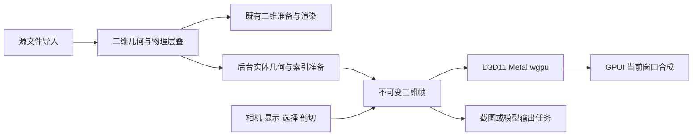

# PCB 三维显示开发设计

> 当前预览显示规则：所有 Via 均显示为实心体，不从 Via 焊盘、铜区或走线挖孔；二维钻孔和 Pin 孔保持实际几何。下文有关真实 Via 孔壁与背钻加工的内容为几何能力和后续物理建模方案，不代表当前预览启用钻孔。


日期：2026-10-18。源码基线：`e87011bbdf1df2505d48457823fe02479b21d668`。本文包含开发方案与实现进度；当前验收状态见 §12.1。功能编号、Ansys 行为证据和未知项见 [HFSS 3D Layout 三维显示调研](hfss3d-layout-3d-rendering-reference.md)。

2026-11-06 补充：以 Pomelo `11995da` 和本地 `references/` 快照核对技术选型，加入帧率优先的实施顺序及 `DemoCase_LPDDR4.brd` 验证计划。性能预算仍为目标；案例统计与首轮 Metal 离屏性能实测见 §13.3—13.4，几何内核对照尚未进行。

## 1. 目标、阶段和约束

目标是让 Pomelo 在现有只读 PCB 查看器中提供可旋转的真实层叠、内部结构检查、显示过滤、选择和输出。第一阶段完成平板层叠的工程三维查看；后续接入元件实体、多区域、外部网格和场结果。

本文采用项目既有的四个 crate 与原生 GPU 路线。保留二维查看及其精确解析曲线；三维使用独立准备数据和渲染管线。继续复用 GPUI 窗口设备与统一呈现，不引入独立交换链、浏览器三维视口或运行时 Ansys 依赖。架构依据见 [GPU 绘制设计](cad-gpu-painter-design.md)、[原生后端](native-gpu-backends.md)和 [ADR 0001](adr/0001-native-gpu-rendering.md)。

只读显示设置保存到 Pomelo 偏好，不写回 PCB。CAD 几何核、真实弯折、场数据读取属于单独扩展；没有数据时保持明确的缺失状态，不能用看似真实的默认厚度、孔壁或封装替代。

### 1.1 技术选型：帧率优先

主路线选定为 **PCB 解析几何 + 物理层叠 → 必要的二维布尔 → 带孔面三角化 → 沿 Z 挤出 → 缓存 Mesh/实例 → 原生 GPU 绘制**。Trace、Pad、Zone、Via 不经过通用 B-rep 内核作为显示前置条件。精确实体运算和 CAD 输出出现明确需求时，再引入 solidcore。

| 方案 | 对本需求的收益 | 成本与边界 | 决策 |
| --- | --- | --- | --- |
| 分层轮廓直接挤出 Mesh | 贴合 PCB 平面结构；易控制细分、实例复用、分块及内存 | 需要正确处理孔洞、连接处重叠和侧壁 | 首期主路线 |
| 全部对象转 solidcore B-rep，再 tessellate | 提供实体拓扑、精确布尔和复杂曲面建模基础 | 增加拓扑构造、中间数据、容差和失败处理；没有本项目大板性能证据 | 不作为首期依赖 |
| 常规 PCB 直接挤出，复杂实体经内核生成 Mesh | 保留精确实体扩展能力，共用 GPU 绘制 | 两种来源都要保留领域身份、单位、误差及完整性报告 | 后续按需求接入 |

区分两类指标：后台建模/网格化决定首次可见时间、峰值内存和精度切换成本；稳定导航帧率主要取决于最终网格、draw 数、可见性处理、透明片元数量和附件带宽。相同 Mesh 与绘制方式下，经过内核不会自动提升 FPS。内核输出也应缓存，不进入旋转和缩放的逐帧路径。

### 1.2 两个参考项目的使用范围

- [GDS3D](../references/GDS3D/README.md)：本地 `gdsoglviewer/gdsobject_ogl.cpp` 使用 Height/Thickness 生成上下表面和侧壁，并做包围盒视锥裁剪，适合作为分层挤出的架构参考。其传统 OpenGL 管线不作为 Pomelo 的后端方案；README 的 Filter 字段还提示不要用于普通层，不能据此认定其透明效果已经适合多层 PCB。项目含 GPL/LGPL 许可文件，源码文件也有 LGPL 声明；本方案不复制其代码，若将来要复用实现需单独核对对应文件许可。
- [solidcore](../references/solidcore/README.md)：本地 `solidcore-tess` 已提供共享边采样、面三角化、Mesh 和显示 LOD。当前 README 仍注明 API 实验阶段及集成覆盖限制。网格器会记录未成功生成的面，调用成功不等于实体完整；接入时必须核对面/边拒绝及超差报告，不允许把缺面结果当成完整 PCB。

本次只调研参考项目，不修改其代码，也不为未来内核扩展预先建立空适配层。

## 2. 现有能力与差距（源码核对）

以下“已有”指代码中存在该基础，不表示本次重新执行了 GPU 或完整文件验收。

| 现有入口 | 可复用基础 | 三维差距 |
| --- | --- | --- |
| [`model/mod.rs`](../crates/pomelo-core/src/model/mod.rs) | Point、LayerId、ObjectId、网络、圆弧线段、逐层 Pad、DrillShape、Via 层跨度、背钻、ComponentPlacement、outline | Point/Bounds 为二维；Layer 无厚度/高度/材料；ComponentPlacement 无实体外形、Z 或模型资产 |
| [`interaction/mod.rs`](../crates/pomelo-core/src/interaction/mod.rs) | Camera 的中心、pixels_per_mm、flipped，二维导航 | 无三维位置、姿态、旋转中心及投影矩阵 |
| [`display.rs`](../crates/pomelo-core/src/display.rs)、[`appearance.rs`](../crates/pomelo-core/src/appearance.rs) | 图层隐藏、类别开关、层序、Layer/Net 着色、颜色覆盖、透明度和标签 | 不能把二维 layer_order 当作物理高度；缺介质/封装类别、网络可见集合和三维模式规则 |
| [`geometry/copper.rs`](../crates/pomelo-core/src/geometry/copper.rs) | 轮廓、孔环、曲线和有预算的铜覆盖网格 | 现有 CopperMesh 以外轮廓覆盖减孔洞覆盖合成，不是可直接拉伸的封闭实体网格 |
| [`interaction/picking_index.rs`](../crates/pomelo-core/src/interaction/picking_index.rs)、[`selection.rs`](../crates/pomelo-core/src/interaction/selection.rs) | 二维索引、类型化选择、网络/元件归属、候选及成员 | 三维需要射线、深度、可见剖切和实体表面身份 |
| [`formats/`](../crates/pomelo-import/src/formats/README.md) | 各格式原生导入、归一单位、已保存铜、轮廓、诊断和取消 | 现有共享输出没有完整物理层叠；源格式有字段不表示已经保留到领域场景 |
| [`formats/hfss/mod.rs`](../crates/pomelo-import/src/formats/hfss/mod.rs) | HFSS/EDB 几何导入入口 | 当前公开模型输出只建立信号层等二维数据，不能据“支持 HFSS”推断支持其完整三维数据 |
| [`document/preparation.rs`](../crates/pomelo/src/document/preparation.rs) | 后台导入、预算、取消、搜索/拾取准备和查看状态恢复 | 增加可按需启动的三维准备阶段及独立失败状态 |
| [`scene/`](../crates/pomelo-render/src/scene/mod.rs) | 图元准备、资源版本、曲线缓存和内存控制 | 新增实体网格、法线、边、实例、空间索引和三维 bounds |
| [`backend/common/`](../crates/pomelo-render/src/backend/common/mod.rs) | NativeGpuRenderer、帧借用设备、平台资源封装 | 现有公共 Draw 以二维/模板覆盖为中心，需三维附件、深度和多遍接口 |
| [`backend/d3d11/driver.rs`](../crates/pomelo-render/src/backend/d3d11/driver.rs) | GPU 缓冲、模板附件与绘制资源 | 当前对应绘制状态关闭深度测试/写入；有 DepthStencil 类型不代表已有实体遮挡 |
| [`shaders/trace.wgsl`](../crates/pomelo-render/src/shaders/trace.wgsl) | 精确二维曲线与坐标补偿；naga 转换为 HLSL/MSL | 当前顶点投影 z=0，不是三维实体顶点变换 |
| [`viewport/`](../crates/pomelo/src/viewport/mod.rs) | BoardViewport 为状态所有者；帧、导航、拾取、显示面板已拆分 | 增加三维状态分支，避免把第二个独立会话塞入面板 |
| [`view_state.rs`](../crates/pomelo-core/src/view_state.rs)、[`preferences/view_state.rs`](../crates/pomelo/src/services/preferences/view_state.rs) | schema=1、来源身份核对、严格反序列化与原子保存基础 | 三维相机和显示预设需要正式迁移，不能只加字段并期望旧文件自动兼容 |

与 [审阅功能设计](viewer-review-development-design.md)共享测量、选择集合、命名视图和输出服务的边界，避免再建一套相同业务。

## 3. 建议架构与文件落点

下表“新增”路径均为建议，当前不存在，实施到对应阶段时再创建。现有模块文件名保持其职责，不为了三维批量重命名二维模块。

| 层次 | 新增或扩展落点 | 输入 → 输出 | 状态所有者 |
| --- | --- | --- | --- |
| 物理模型 | 新增 `pomelo-core/src/model/stackup.rs`、`geometry3d.rs` | 归一层叠/轮廓/孔跨度 → 物理结构契约 | BoardScene 的只读物理扩展 |
| 三维导航 | 新增 `pomelo-core/src/interaction/camera3d.rs` | 导航命令、视口尺寸 → Camera3d | BoardViewport |
| 显示策略 | 新增 `pomelo-core/src/display3d.rs` | 基础显示、三维覆盖、选择 → 可见性/材料快照 | 每文档 View3dState |
| 导入 | 扩展 `pomelo-import/src/formats/` 与 `scene_builder.rs` | 各格式受支持的物理数据 → 统一结构及诊断 | 导入后台任务 |
| 网格准备 | 新增 `pomelo-render/src/scene/solid/` | 物理模型、曲线容差、预算 → PreparedBoard3d | 后台准备任务 |
| 三维渲染 | 新增 `pomelo-render/src/backend/solid_renderer.rs`、`backend/common/solid.rs` | 不可变 Board3dFrame → 平台绘制命令 | 窗口 GPU renderer |
| 平台资源 | 扩展 D3D11/Metal/wgpu 各自 driver、shaders | 公共三维绘制语义 → 本机资源/编码 | 当前设备资源代次 |
| 着色器 | 新增各平台 `solid`、`solid_edge`、`solid_composite` 着色器 | 顶点/实例/帧 → 颜色、深度、边及合成 | pomelo-render |
| 应用接线 | 新增 `viewport/view3d.rs`，扩展 frame/navigation/gesture/picking | 工具动作 → 核心命令及帧 | BoardViewport，不由面板另存相机 |
| 面板 | 组合现有 layers/display/inspector，必要时新增 `panels/stackup.rs` | 只读展示模型、命令回调 | 面板仅有焦点、滚动、输入暂存 |
| 保存与输出 | 扩展现有偏好服务；新增导出服务 | 版本化快照 → 偏好或用户选择路径的文件 | 后台服务 |



## 4. 数据契约：先补真实结构

### 4.1 物理层叠

建议给 BoardScene 增加可选的 `PhysicalBoard`，保留现有 LayerId 的二维身份。物理层通过 LayerId 关联，而不是重新按列表位置编号。

| 契约 | 建议字段与不变量 |
| --- | --- |
| PhysicalBoard | stackup 类型、物理层、板域、材料、区域、模型来源和能力报告；可缺失 |
| PhysicalLayer | layer_id、region_id、lower_z_mm、thickness_mm、material_id；upper=lower+thickness；显式记录零厚度层语义 |
| StackupRegion | 稳定区域身份、带孔区域轮廓、该区域有效层叠；现有同名轻量引用只含来源/code，不能视为已有完整区域 |
| BoardDomain | 闭合板边界、内开槽、岛；不以整个 scene.bounds 矩形代替板形 |
| Material | 来源名称、工程类别及显示颜色；电磁材料参数与视觉参数分离 |
| DrillSpan3d | 对象身份、实际 Z 起止、孔截面、镀层状态、可选镀层厚度、背钻段；未知跨度不自动贯通 |
| ComponentBody | component_id、安装面、放置变换、包络或外部模型引用、真实高度、外形质量等级 |
| Quality/Provenance | source、explicit-user-preview、inferred、missing、unsupported 等来源；实体/示意/缺失分开 |

统一采用右手坐标和毫米：XY 延续已有板坐标，+Z 指向板顶。顶层/底层标签和源格式层序通过导入适配为该坐标。CPU 用 f64；GPU 用相对渲染原点的 f32 或经过验证的高低位拆分，防止大坐标板细节抖动。

不能由 LayerId、UI 排序或两层铜之间的序号推断距离。Laminate 可在有厚度和有序层叠时累计高度；Overlapping 必须保留显式高度，不能套用累计算法。空气层或显式零厚度层保留来源，不给未知层填零制造“已知”。

### 4.2 导入与缺失数据策略

1. 各读取器先建立“能提供哪些物理字段”的能力表，再输出统一契约；不在 UI 判断源格式字符串来猜厚度。
2. 扩展 HFSS 入口只处理经样本证实的层叠数据；现有单 cell、未加密等支持边界继续保留，未知扩展返回明确诊断。本文不记录专有二进制字段布局。
3. 板轮廓闭合检查先于实体准备。若开放线段不能确定板域，显示已有二维边，不把铜的包围盒当板材。
4. 缺物理层叠时仍可二维查看。可提供用户明确启用的“示意层间距”预览，但要标注“示意”；禁止用其输出真实孔深、板厚和物理 CAD。
5. 缺封装外形或高度时保留元件定位符；有足够包络和高度才生成简化实体。简化实体必须能追溯质量等级。
6. 错误按层/对象定位。三维准备失败不得导致已成功的二维文档被关闭；显示三维不可用原因和回到二维的操作。

建议诊断类别：层叠缺失、层高冲突、开放板轮廓、非法孔跨度、未知镀层厚度、缺元件模型、三维准备预算不足。用户消息加入共享 MessageKey 和五语资源，原始来源详情保留在技术字段。

### 4.3 兼容模型与缓存

旧的共享场景可以没有 PhysicalBoard。几何和资源键包含源摘要、解码身份、物理模型版本、几何容差与模型资产摘要；改变颜色或选择不重建几何。新场景字段需评估已有样本构造器和序列化调用；不把 UI 偏好 schema 与领域场景版本混为一个编号。

## 5. 从二维几何生成实体

### 5.1 通用流程

`解析路径 → 校验轮廓 → 正/负区域求实际覆盖 → 三角化带孔面 → 顶/底/侧面 → 法线/边 → 对象映射 → bounds/BVH`。

已有 CopperMesh 的孔洞是覆盖相减：直接把其所有 indices 放入三维顶面会把孔再次填回去。应从原始 rings/paths 构造真实多边形差集，对孔洞合并、接触和多个岛采用确定的拓扑规则，然后三角化可见区域。现有 `earcut` 可复用在合法多边形上；现有 `clipper2-rust` 位于 import crate，若通用三维准备需要布尔能力，应把受限封装移到核心几何边界或调整依赖，不能让 render 的生产代码反向依赖 import。

布尔库使用整数坐标时，制定明确 mm→整数比例、误差预算与溢出检查。输入/输出保持 source ID 映射；三角形编号和 GPU draw 编号不能替代领域身份。自交、共线重叠、退化小环和失败拓扑需输出诊断；不得仅为了“能画”静默闭孔。

### 5.2 各类结构

| 对象 | 实现方式 | 重点边界 |
| --- | --- | --- |
| 板材/介质 | 板域按各层 Z 区间挤出，开槽和适用钻孔从体积中扣除 | 钻孔只切穿真实跨度，不将盲孔打穿全板；层内填充按数据覆盖 |
| 铜皮/平面 | 有厚度的覆盖区域，顶底面和外环/孔环侧壁 | 负片层先在有限板域内做补集；同层已保存铜不重新铺铜 |
| 走线 | 中心路径按宽度生成二维扫掠区域，再按铜厚挤出 | 保留端帽/连接处；圆弧误差按场景精度控制，避免自交接缝 |
| 焊盘 | 复用 PadKind/CustomPadGeometry 的二维形状，再按实际层高挤出 | 自定义孔、offset、旋转、镜像、donut 与跨层实例 |
| 孔/槽/孔壁 | 真实圆孔或槽截面沿跨度生成内壁；背钻分段处理 | NPTH 无铜壁；未知镀层厚度不能生成可测量的“真实壁厚” |
| 背钻 | 从入口到停止高度去掉对应孔壁/焊盘部分，保留剩余段 | start/stop/protected_layer 映射到物理层，并区别显示直径与制造尺寸 |
| 元件包络 | 来源轮廓按高度挤出，按安装面和放置变换实例化 | 底面用经过定义的安装变换，镜像会影响绕序/法线 |
| 三维组件 | 共享 mesh 资产 + 实例变换 + 材料/选择元数据 | 单位、原点、旋转次序、负行列式变换、层级与缺失资源 |
| 键合线/焊球 | 有真实三维路径/球体参数时生成管状/球状实例 | 现有平面 bond_wire 信息不足以恢复真实弧高；未知时只显示示意并标记 |

不要对所有铜、走线和焊盘做整板全局 CSG。按对象/层/空间块生成并在必要范围处理孔和负片；接触处优先用一致表面规则解决，不以普遍抬高图元制造错误的 Z 距离。

### 5.3 PreparedBoard3d

输出至少包括顶点/法线/索引、材质槽、边索引、分块 bounds、对象到子网格范围、层/网络/元件归属、实例变换、拾取数据、误差与缺失报告。面类别保留 top/bottom/side/hole，用于属性和未来测量。

重复焊盘/孔/封装使用实例和共享网格。批次按不透明性、材料与层/类别组织；显示过滤更新小型 bitset/实例可见性表。不要在每次旋转时重新遍历所有源路径。

### 5.4 帧率优先的几何生成规则

1. **Trace**：按线宽、端帽和连接规则构造平面覆盖，再沿铜厚挤出；圆弧用有误差上限的采样。按层和空间块合批，不按每个 Segment 发起一次 draw。
2. **Pad**：复用现有 PadKind、自定义路径和放置变换。轮廓、尺寸、孔型及容差相同的几何共享网格；实例保留源对象身份、层、网络及变换。
3. **Zone**：先求外轮廓减孔洞并集的实际覆盖，再三角化顶底面；外环和孔环生成朝向正确的侧壁。现有覆盖网格索引不能直接复制为实体顶面。空间分块需保持边界一致，不能在块接缝处制造物理侧壁。
4. **Via**：逐层焊盘环与孔壁分开建模，圆孔/槽孔按真实跨度生成，背钻和盲埋孔按 Z 区间分段。相同孔型、细分级别和截面的网格复用，实例记录位置、方向和跨度。NPTH 不生成镀铜壁。
5. **介质和板材**：贯穿该 Z 区间的孔在二维截面处理后挤出；孔截面或覆盖改变处再分段。避免把逐孔三维实体减法作为整板准备的默认算法。

Trace、Pad、Zone 连接处的重复顶面会引起深度冲突，透明时还会重复累计颜色。仅对受影响的同层局部覆盖做必要的二维合并、裁剪或表面归属处理，保留来源映射和源对象拾取信息；不能靠随机 Z 偏移掩盖，也不做无差别整板全局 CSG。透明 OIT 不会修复重复几何。

CPU 解析路径保留 f64。GPU 顶点采用相对原点坐标，法线和身份数据按实际需要存储，先核算顶面、底面、孔壁、索引及缓存同时驻留的峰值。现有 `scene/copper.rs` 记录过 RDIMM 源的约 1970 万顶点/5780 万索引，这是另一个案例的二维规模，不能当成 LPDDR4 或未来三维的统计；它提示不能无预算地复制二维数据生成全量三维结构。

曲线首版使用少量离散 LOD 和有界缓存，按屏幕投影误差选择并避免阈值附近频繁切换。LOD 准备在后台完成，不能每次导航同步细分整板。简化要保留孔洞和电气隔离拓扑；未显示的细节不得被当成不存在。

## 6. 三维相机、显示变换与导航

### 6.1 相机契约

Camera3d 包含 pivot、单位四元数 orientation、正交视域高度、有效裁剪深度；如以后增加透视，另含 distance、FOV。当前阶段先交付正交观察，透视是 Pomelo 可选扩展，未列为已核实 Ansys 能力。

- 旋转采用可从当前状态中断的 trackball/orbit；不使用会在极点翻转的裸欧拉角累加。
- 平移由相机 right/up 和“毫米/逻辑像素”计算；DPI 只在主机坐标到物理附件处转换。
- 光标锚点缩放使用 pivot 所在观察平面或真实命中点，固定选择策略，避免透明物体造成锚点跳变。
- Fit All/Selection 使用实际显示 AABB 的八角投影，考虑画布比例与留白，不能用二维 XY 范围忽略孔/元件高度。
- 标准方向明确定义相机朝向和 up；Bottom 必须能看到板底，不能只调用现有二维 flipped。
- 零尺寸视口、空选择、极小 bounds、NaN、无效四元数返回可解释结果。near/far 与场景尺寸关联，避免层间深度精度耗尽。

二维和三维相机分别保留。首次从二维进入三维，以二维中心与可见范围推导 pivot/视域并选轴测方向；返回二维不覆盖原二维缩放。导航历史在手势完成时记一条，包含三维方向、pivot、视域和显示变换；设置有界容量和前后栈。

### 6.2 Z 拉伸

保存物理 `z` 与展示 `z'` 的区别：`z' = z_anchor + scale × (z - z_anchor)`，scale 为有限正数。层和孔段端点服从同一变换，倍率变化只更新变换/包围范围，不重建源几何。

非均匀 Z 变换的法线用逆转置变换并归一化。拾取先把世界射线经展示变换逆变换，再与物理几何求交；返回物理点和展示点。测量始终用物理点，不能将拉伸后的孔段作为真实长度。

首期只承诺平板层叠的 Z 拉伸。组件外壳采用“安装点随层移动，实体尺寸不变”的策略，界面说明其作用范围；若追求整个模型非均匀拉伸作为另一模式，需分别验收。刚柔板阶段不能未定义地叠加全局 Z 拉伸和弯折。

## 7. GPU 渲染与平台接入

### 7.1 帧和附件

增加 Board3dFrame，持有 PreparedBoard3d 的 Arc、camera snapshot、display/selection/clip revision、渲染原点、灯光、GPUI bounds/clip/DPI 参数。renderer 使用 NativeGpuRenderer 接口；当前二维 BoardFrame 和 BoardRenderer 不承担三维兼容开关堆积。

建议在同一 GPUI 设备和绘制回调中，使用由 pomelo-render 管理的三维离屏颜色/深度附件，再把颜色作为纹理合成到当前窗口目标。这样三维深度、多遍透明与 GPUI 自身的模板/覆盖不互相污染。这是对现有 driver 的新增能力，不是当前接口已支持的假设；M0 必须验证创建、采样和编码顺序能在三端落地。

离屏附件属于必要辅助资源，不另建 swapchain，不自行 present，不保存跨帧借用的窗口目标。尺寸以物理像素建立，scissor 对应有效 clip；缩放/resize 失效附件，颜色空间和 alpha 必须符合 GPUI 当前目标。若验证可安全直接绑定自有 depth 到借用颜色附件，可作为后续优化，但先保留一种一致的合成语义。

### 7.2 绘制遍次

1. 清空三维离屏颜色与深度；背景和空间网格按定义绘制。
2. 不透明面：深度测试与写入开启；先采用常规 0..1 深度，远端清为 1，比较 LessEqual。矩阵、绕序和背面规则在三端统一。
3. 半透明面：保留不透明深度测试、关闭透明深度写入。简单按块排序只作为明确标注限制的中间验证；多层 PCB 正式透明显示采用加权混合 OIT 或经验证等价方案。
4. 边、轮廓和选中对象叠加：避免画出所有三角剖分对角线；区分物理边与内部网格边，使用屏幕像素宽度与有限深度偏置。
5. 测量、文字、方向轴、剖切手柄：明确深度测试/始终可见策略，不让普通选择高亮无意穿透不透明板材。
6. 合成到 GPUI 当前目标，应用宿主内容裁剪及整体透明度。

加权 OIT 使用 accumulation/revealage 附件及合成；权重针对毫米尺度和深度范围设计，不沿用任意常数。它是近似合成，不能宣称等于精确光学。浮点附件、混合格式与并行输出数量需查询设备支持；若平台缺能力，提供可解释降级和视觉测试，不能静默呈现错误层序。

内部观察默认优先提供“隐藏/淡化介质，铜保持不透明”；多层铜同时透明采用 Weighted Blended OIT。不透明物体写深度，透明物体只对不透明深度测试、不写透明深度，最后合成到同一场景颜色。隐藏介质时不提交其几何；alpha=0 的对象直接跳过。

| 透明方案 | 优点 | 边界 | 选型 |
| --- | --- | --- | --- |
| 普通 Alpha + 对象/块排序 | 接入成本低 | 相交、嵌套及跨层孔壁无法保证每像素顺序 | 仅用于中间验证 |
| Weighted Blended OIT | 不需逐三角形排序，附件内存有界 | 高不透明度或强颜色差异时有混色误差；仍处理全部可见透明片元 | 正式交互透明方案 |
| Depth Peeling | 提取足够深度层时可准确合成 | 多遍绘制；遍数不足会省略更深片元，多层铜增加成本 | 首期不采用 |

OIT 的固定附件内存不代表固定帧时间。整板铺满屏幕、铜层和孔壁大量叠加时，像素填充与混合带宽可能先于三角形吞吐成为瓶颈。闭合薄铜的顶底面、孔内壁都影响透明结果；用实际案例验证正反面策略，不能为省片元任意删除从板底或孔内应可见的面。这里使用表面透明度做工程观察，不模拟介质的体积吸收或真实折射。

依据：[Weighted Blended OIT 原始论文](https://jcgt.org/published/0002/02/09/)描述有界内存的近似混合；[Diligent 官方示例](https://diligentgraphics.github.io/docs/d0/d40/DiligentSamples_Tutorials_Tutorial29_OIT_readme.html)说明高不透明度和权重调节限制；[Khronos Depth Peeling 示例](https://docs.vulkan.org/samples/latest/samples/api/oit_depth_peeling/README.html)说明逐层 gather、合成及遍数不足时的省略行为。

### 7.3 视觉材料

首期使用可调基础色、环境项和方向漫反射，保证铜与介质可读；这是 Pomelo 的视觉设计选择。源层颜色和用户覆盖继续可用，视觉高光不改变工程材料。PBR、阴影、环境贴图不作为对标首期依赖。

GPU 数据布局使用明确的顶点/实例/帧结构、对齐和布局断言；统一维护 WGSL，由 naga 生成 HLSL/MSL。D3D11/Metal 必要 unsafe 仅放平台模块既有允许边界。不要把 CPU 核心几何放进平台 driver。

### 7.4 资源与失效

| 变化 | 应更新 | 不应发生 |
| --- | --- | --- |
| 旋转/平移/缩放 | 相机 uniform、可见块、必要 LOD | 整板解析和上传 |
| 颜色/选择/透明度 | 材料或选择表；opaque/transparent 批次分类变化 | 重建所有顶点 |
| 隐藏层/网络 | 可见 bitset、draw ranges、可拾取快照 | 丢失源对象或重编 LayerId |
| Z 倍率 | 变换、展示 bounds、相关索引查询参数 | 修改物理厚度 |
| 剖切平面 | plane uniform、手柄和拾取裁剪 | CPU 重切全板作为每帧前提 |
| 几何/精度级别 | 有变化的块、索引和版本 | 过期准备结果覆盖新文档 |
| DPI/视口尺寸 | 离屏附件、投影、scissor、文字布局 | 重解析源文件 |
| 设备重建 | 全部设备资源 | 持有旧设备的纹理和窗口目标 |

### 7.5 优化实施顺序

先建立 CPU/GPU 分段计时，再依次验证：静态几何缓存和一次上传 → Pad/Via 实例化与 Trace/Zone 合批 → 按空间块视锥裁剪 → 离散曲线 LOD → 透明绘制优化。每一步记录所减少的 draw、顶点、片元压力或上传量，避免只凭平均 FPS 判断。

视锥裁剪在整板全部入镜时收益有限；透明后方片元也不能沿用不透明遮挡规则直接剔除。仅在实测透明填充受限时增加交互低分辨率透明附件，停止导航后恢复完整分辨率，并验证边缘和深度对齐。交互降质先减标签和曲线细分，再评估透明分辨率，不能静默丢失层或对象。

首期不加入 GPU 驱动间接绘制、mesh shader、光线追踪或自建渲染引擎。若上述路径仍不能满足已声明样本和设备的预算，再根据 CPU 提交、GPU 几何或透明带宽的实际瓶颈选择下一步。

## 8. 显示规则、选择及剖切

### 8.1 统一显示判定

由核心层生成只读显示快照，渲染、拾取、Fit Selected 和导出共同消费。基础可见条件按层/区域、图元类别、网络和对象显隐取交集。无网络的介质和元件外壳不被错误套用 NetId(0) 的网络过滤。

建议保留 `BoardDisplay` 的二维字段，新增三维覆盖：render mode、物理层样式、show_dielectrics、hole display policy、component bodies、clip planes、Z scale、interaction quality。共享字段的所有者只有一个，不能二维和三维各复制一套相互漂移的图层隐藏表。

规则顺序：可见性 → 全局模式 → 逐层线框覆盖 → 材料颜色/透明度 → 选择强调。Default 使用来源/用户层样式；Sketch 绘边；Solid 默认不透明，但保留逐层线框。I05/I06 选择强调作为临时显示覆盖，不改层设置。源 transparency 百分比转换为 `opacity=1-T/100`，数值范围、线性/非线性颜色与 alpha 约定统一。

“透明”和“隐藏”分开：alpha=0 默认不参与普通最近表面拾取；如果需要选透明对象，提供显式选项。内部对象循环选择可以穿透可见表面，但必须排除隐藏、被剖切移除和类别过滤对象，并在候选提示中说明当前序号/身份。

Show Dielectrics 触发的连续孔显示是独立展示策略：从真实孔跨度与可见层计算展示段，绝不覆盖源 DrillSpan3d。跨区域孔不能简单按全板最上/最下层连接。

### 8.2 拾取和高亮

首期采用 CPU 分块 AABB/BVH 与三角形射线求交，复用源身份与网络/元件关系。悬停查询节流并带相机、显示和文档代次；移动中的旧结果不可覆盖新视图。每帧复制全模型做拾取不可接受。

GPU ID picking 可后续加入，使用整数对象键附件、异步读回和过期检查；不能把透明混合后的颜色反推对象 ID。边选择以投影边段距离和深度为依据；屏幕像素容差随 DPI 转换，不能用固定毫米容差。

扩展可拾取类型区分 ComponentBody、DielectricBody、ClipPlane 等视图对象与既有 SelectedObject；避免伪装成 Via/Zone。一个源对象可有多个网格命中，候选按领域身份去重。Properties 显示物理厚度、Z 跨度、来源和质量等级，只有示意数据时明确标注。

### 8.3 剖切

ClipPlane 保存稳定 ID、物理空间单位法线 n、常数 d、启用状态和手柄状态，统一“保留 `dot(n,p)+d >= 0`”的约定。首期设定有界平面数量，并在 UI 解释限制；不能无界增加 shader uniform。

着色器在同一物理坐标对不透明、透明、边、结果覆盖及 picking 测试平面。若几何已经经 Z 展示变换，使用正确的逆变换位置/平面变换计算，不混用空间。新增平面操作可在 Pomelo 查看状态撤销，不修改源设计。

首期剖切只裁显示，不承诺自动封口。若新增截面填充，单独做 mesh/plane 相交线收集、闭环、孔拓扑和切面三角化；不能跨越铜孔填一个大面，也不能把切面生成当作可靠 CAD 实体布尔结果。

## 9. 界面、持久化与输出

### 9.1 交互组合

主要任务是“观察当前 PCB 层叠并定位内部对象”。BoardViewport 保持相机/显示/工具的所有权，沿用现有文档标签、可调整侧栏和检查器。建议工具栏提供 2D/3D 切换、适应整板、方向、显示模式和剖切；逐层设置放现有层面板，模型来源和缺失原因放检查器/诊断面板。

GPUI Kit 界面要求：命令使用 Button/Action，模式使用有持久选中态的现有选择控件；逐层矩阵使用虚拟化列表或表格；设置用 Checkbox/Slider/Input 的语义组合，倍率和透明度同时可键盘输入。主题、尺寸和间距遵循 [GPUI Kit Design Guides](https://gpui-kit.com/docs/design-guides.md)，不照搬 Ansys 的固定像素工具栏。

进入三维显示“准备中”只对应真实后台任务；失败保留二维和文档上下文。无选择时 Fit Selected 禁用并给原因。Escape 依次取消当前手势/工具预览、关闭顶层弹出并恢复焦点。菜单、上下文和键盘调用同一命令，不把主要功能藏在 hover 按钮中。新增文案进入五种语言，不拼接翻译片段。

建议先保持项目的 F2 适应整板等既有键位；三维旋转/平移/缩放提供显式工具和可配置绑定。Ansys 兼容键位只能作为可选配置，避免 Ctrl+R 等与现有重载冲突。方向切换默认直接完成；若增加过渡，遵守减弱动态效果偏好且可中断。

### 9.2 查看状态迁移

现有 ViewState 拒绝未知字段且验证 schema=1。建议引入显式 V1/V2 解码分派，V2 保留 camera2d 并增加可选 camera3d、active_view、display3d、命名视图和剖切状态。先迁移再校验，不在旧结构上强行反序列化新字段。

V1→V2 保留原二维状态，三维首次进入时初始化；未知新版本返回诊断并保留文件；源身份不匹配时不恢复对象选择/剖切绑定。无效倍率、非有限坐标、非单位四元数和超量 plane/对象集合均拒绝或按明确规则修复。继续使用 JsonFileStore 原子保存和损坏备份机制。

命名“可见性视图”和“完整三维视图”分开契约：前者保存层/网络过滤；后者额外保存相机、Z scale、clip、模式和选定显示字段。恢复不得改变全局语言、主题或文档源数据。

### 9.3 截图和模型输出

截图服务固定一份完整帧快照，先等待该快照必需资源就绪，再渲染到指定尺寸离屏目标并异步读回。输出选项明确是否包含网格、方向轴、测量、标签和选择。高分辨率不通过放大窗口完成；PNG 可复用现有 image 依赖，JPG 需另行启用编码能力。Copy Image 在用户执行时写系统剪贴板。

模型输出与截图分离：可先交付带单位/元数据的网格格式作为 Pomelo 扩展，不能宣称等同 Ansys SAT/Parasolid CAD。真实 STEP/SAT/Parasolid 输出需要几何核、实体拓扑和许可评估；当前三角形网格不能靠改扩展名实现。示意层叠禁止导出为“真实制造模型”；Z 拉伸默认不进入物理模型输出。

## 10. 高级数据功能的实现路径

| 功能组 | 所需新增数据 | 实现边界与建议 |
| --- | --- | --- |
| 多区域/重叠层叠 | 区域多边形、区域层表、显式层高 | 分区建体和空间索引；先支持平板 multizone，再处理重叠材料冲突；缺数据不显示全局假层 |
| 外部模型/层级 | 共享 mesh 资产、实例树、模型坐标与来源 | 可选新增独立模型导入模块；先支持公开网格资产，CAD tessellation 另接适配器；不可解析资产只显示有依据的包围范围 |
| 刚柔板 | 固定区域、弯折轴/范围、半径、角度、层叠中性参考和层级依赖 | 必须按弯折区域变形及传递后续区域刚体变换；跨边界曲线先细分，法线随变形计算；不能拿整层矩阵旋转模拟弯曲 |
| 弯折简化和动画 | 低细节形状、可评估参数序列 | 交互时简化、停止后恢复；帧缓存有界；此项是数据驱动动画，不用镜头环绕代替 |
| 端口/边界/空气盒 | 源范围、端口几何和归属 | 独立辅助类别，只显示已有定义；不从 PCB bounds 猜求解边界 |
| 预处理/求解网格 | 节点、单元、层/对象/区域关联 | 与渲染三角网格分离；线框/面显示共享裁剪，按类别过滤 |
| 场结果 | 已计算采样、复数量、单位、坐标、解上下文/频率/相位 | 新增只读结果数据适配器，生成标量色图/向量实例、图例和范围；未支持量标记缺失，不执行求解 |
| 场与参数动画 | 明确帧序列、上下文和时间/参数轴 | 有界流式读取、暂停/拖动/取消；同帧几何/场/图例一致，导出编码器独立 |

这些扩展优先读取明确、合法可用的数据接口；不在渲染循环直接读取 EDB，不依赖反编译 Ansys 算法。高级数据接口实现前需确定实际格式和样本，不能凭本次当前窗口生成不存在的数据。

## 11. 功能编号到开发任务的完整映射

M 编号定义见下一节。所有 59 项均有实现或有条件扩展路径；未知 Ansys 行为不作为强制等价验收。

| 调研编号 | Pomelo 对应开发任务 | 批次 |
| --- | --- | --- |
| V01、V02、V03 | Camera3d 旋转、平移、锚点/步进缩放，接入 gesture/navigation | M2 |
| V04 | 三维正交相机矩形区域缩放；区域投影和 DPI 一致 | M2 |
| V05、V06 | 全部/可见选择三维 bounds 投影适配 | M2 |
| V07 | 有界相机历史，手势结束提交 | M5 |
| V08、V09 | 六正交/三轴测方向与重置俯视命令 | M2 |
| R01、R02、R03、R04 | display3d 模式与层覆盖；面/物理边批次 | M3 |
| R05 | 逐层 opacity、透明合成和设备降级 | M3 |
| R06、R07 | 复用颜色覆盖与 Layer/Net 材料解析 | M3 |
| R08 | 明确世界/屏幕空间的工程图案，Default 样式和主题对比 | M5 |
| R09 | 带误差预算的曲线 LOD/固定容差，缓存失效 | M3 |
| L01、L02、L03 | 完整类别矩阵、列批量开关、层隔离；二维兼容 | M3 |
| L04、L05 | 介质显隐、真实孔跨度和孔显示段分离 | M3 |
| L06 | 网络可见集合与 show/hide/isolate/show-all 命令 | M3 |
| L07 | 网络类/差分/扩展网络成员模型；复用搜索，显式正则模式 | M5；源分组导入随数据支持 |
| L08 | 元件列表/分类、定位和实体映射 | M4；分类缺失不猜测 |
| L09 | 可见性预设及 Surface；与完整三维视图区分 | M5 |
| L10 | 按区域过滤及区域层叠 | M7 |
| L11 | 非物理类别与物理层独立可见性 | M3 |
| S01 | PhysicalBoard、层高与区域数据、介质实体 | M1；复杂区域 M7 |
| S02 | padstack 实体、孔壁/背钻、非功能焊盘及 antipad 规则 | M1/M3；数据不够时诊断，不重新铺铜 |
| S03 | 带孔覆盖实体化、负片有限域、介质填充 | M1/M3 |
| S04 | 来源包络/高度驱动的封装与散热器几何 | M4；热参数只展示 |
| S05 | 三维资产实例树、层级进入/返回和共享坐标 | M7 |
| S06 | 有来源的键合路径和焊球几何 | M7 |
| S07 | 区域弯折、简化和参数帧 | M7 |
| I01 | 三维对象和边选择；Handle 仅用于查看工具手柄 | M4；源设计控制点编辑不实现 |
| I02 | 按射线深度候选、按领域对象去重和循环 | M4 |
| I03、I04 | 预选、首次/追加选择颜色和检查器联动 | M4 |
| I05、I06 | 非选择淡化和选中线框实体化 | M4 |
| I07 | 物理字段、来源、质量等级展示 | M4 |
| I08 | 共用审阅工具状态，物理坐标测量和覆盖层 | M5 |
| C01 | 显示 Z 变换、预览取消、法线与逆变换拾取 | M3 |
| C02 | 多平面、数值/手柄操作、共享裁剪 | M5；截面封口另立扩展 |
| A01、A02 | 世界网格/方向轴、背景，复用已有外观设置 | M2/M3 |
| A03、A04、A05 | 源文字/标签、连接符号、来源连接飞线覆盖层 | M5 |
| A06 | 只读仿真范围和端口覆盖层 | M8 |
| A07、A08 | 当前帧截图、独立预览和剪贴板，明确输出内容 | M6 |
| A09 | 网格输出先行；精确实体 CAD 输出单独评估 | M6（网格）/高级扩展（CAD） |
| A10 | 外部预处理/求解 mesh 适配和分类显示 | M8 |
| A11、A12 | 场覆盖、图例、上下文和有界帧序列/输出 | M8 |
| A13 | 复用工作区布局保存；三维工具状态与文档隔离 | M2/M5 |

## 12. 可执行开发批次

| 批次 | 必须交付 | 依赖 | 退出条件 |
| --- | --- | --- | --- |
| M0：GPU 接入验证 | 三端离屏颜色/深度、采样合成、裁剪/DPI/销毁恢复；相交盒子；计时与 OIT 附件能力探测 | 现有 native painter | 深度遮挡及 UI 裁剪正确；记录每端设备和基础开销后冻结帧契约 |
| M1：物理模型和实体准备 | 层叠/板域/钻孔契约；带孔直接挤出；Pad/Via 共享网格；局部重叠处理及预算；LPDDR4 CPU 清点 | 数据契约 | 合成孔/槽/盲孔/背钻通过；案例统计及物理数据缺口明确，缺面不静默通过 |
| M2：可用三维视口 | 2D/3D、相机、方向、不透明绘制；静态上传、合批及分块裁剪；LPDDR4 首次实板验证 | M0/M1 | 可看板顶板底；导航无整板重建/上传；二维及多文档正常；提交不透明帧时间和内存记录 |
| M3：PCB 显示语义 | 三模式、层/网络过滤、介质/孔段、Weighted Blended OIT、离散 LOD 和 Z 拉伸 | M2 | 多层透明及拾取一致；完成案例性能矩阵；必要降质经过对照且停止后恢复 |
| M4：可检查对象和封装 | 三维 BVH、候选循环、选择效果、检查器、来源包络实例 | M3 | 隐藏/裁切对象不误选；旋转/拉伸后准确定位；缺封装不伪造实体 |
| M5：剖切与审阅 | 多剖切、测量、可见性/完整视图、历史、文字和辅助标记、版本迁移 | M4 | 拉伸前后物理测量一致；保存恢复精确；旧状态可迁移；取消和错误可恢复 |
| M6：输出 | 固定快照 PNG/预览、剪贴板、明确限制的网格输出 | M5 | 输出与视图配置一致，异步不阻塞 UI；单位/源身份和示意标记可追溯 |
| M7：复杂结构 | 多区域、重叠、外部模型、层级、真实键合/焊球、刚柔板 | M4，按功能增加数据 | 每项都有独立公开样本和验收，不能仅以按钮可见宣告完成 |
| M8：已有结果显示 | 空气盒/端口、求解 mesh、场和帧播放器 | M5/M6 + 明确结果数据接口 | 数据量/单位/坐标与来源一致，裁剪/过滤/图例同步，无结果时禁用并解释 |

M0—M4 是第一组可用里程碑；M5—M6 形成完整检查和交付流程；M7—M8 是有数据前提的扩展。按依赖完成纵向流程，不一次建立所有空入口。本次未做工期估算；应以 M0 的设备验证和 M1 的数据覆盖确定人力与周期。

帧率优先的近期交付顺序是：LPDDR4 CPU 数据清点 → M0 GPU/深度与透明附件验证 → M1 直接挤出 → M2 实板不透明基准 → M3 透明及 LOD 基准。首个平台可先打通完整流程，其结果只代表该设备；三端接入和硬件验证仍是对应阶段的退出要求。M4 以后的功能不作为启动性能验证的前提。solidcore 不阻塞这些批次；出现精确实体需求后，可从案例选一块 Trace/Pad/Zone/Via 局部区域做独立对照，检查准备耗时、峰值内存、网格规模、孔洞和面完整性，再决定接入范围。

### 12.1 开发进度（2026-11-06）

首个 macOS 原生 Metal 三维查看流程已实现；真实 LPDDR4 case 已完成 CPU 准备、GPU 离屏绘制、像素验证及性能测试。应用视口接线已编译，用户已在本机终端运行并确认三维正常显示；完整鼠标交互验收仍未逐项完成。以下是实现范围，不代表 M0—M4 的全部退出条件已经满足。

| 落点 | 已实现与验证 |
| --- | --- |
| [`geometry3d/solid.rs`](../crates/pomelo-core/src/geometry3d/solid.rs) | Clipper2 平面整理、Earcut 带孔顶底面、侧壁及法线、局部原点、预算和取消。9 项专项测试验证面积/体积、逐壳闭合、重叠孔、自交分岛、大坐标及走线；孔偏移和输出显式使用 `Vec<u32>`，已修复用户遇到的 never type 编译错误。 |
| [`geometry3d/drill.rs`](../crates/pomelo-core/src/geometry3d/drill.rs) | 同轴实际刀径和加工 Z 区间求孔壁保留段；8 项测试。偏心及不足以覆盖孔壁截面的径向切削明确不支持。 |
| [`interaction/camera3d.rs`](../crates/pomelo-core/src/interaction/camera3d.rs) | f64 四元数正交相机，orbit/pan/光标锚点缩放/八角 Fit/射线；相对原点的 0..1 深度矩阵，核心测试通过。 |
| [`scene/solid.rs`](../crates/pomelo-render/src/scene/solid.rs) | Trace、Pad、Zone、Via 孔壁的局部实体和独立放置；保留对象、网络、层/跨度身份。12 项场景测试通过，含镜像、偏置钻孔和真实背钻分段。 |
| [`scene/board3d.rs`](../crates/pomelo-render/src/scene/board3d.rs) | 全板准备、按层合批 Trace/Zone、缓存 Pad/Via 原型并实例化；源相对坐标、可见性/颜色/透明度与选择材料，点击 AABB+三角形射线拾取。2 项全板测试覆盖重复原型、过滤、隐藏/零透明度与预算/取消。相机移动不重新三角化或上传几何。 |
| [`shaders/solid.wgsl`](../crates/pomelo-render/src/shaders/solid.wgsl)、[`metal/driver/solid.rs`](../crates/pomelo-render/src/backend/metal/driver/solid.rs) | 不透明深度写入、透明深度测试、RGBA16F 累积/R16F reveal 的 Weighted Blended OIT，最后合成到 GPUI 窗口目标；静态缓冲和尺寸缓存、附件内存上限。真实 Metal 像素测试通过，验证前后遮挡、孔洞和透明绘制顺序反转。 |
| [`viewport/view3d.rs`](../crates/pomelo/src/viewport/view3d.rs) | 2D/3D 切换、后台准备、旋转/平移/缩放/Fit、实体/透明切换、Z×1/2/5/10/20、顶视/底视/轴测预设、图层/类别/网络显示、点击检查与搜索定位、五语言提示；退出释放 GPU 资源，二维相机保持。应用编译和 Clippy 通过，用户已确认窗口显示；完整鼠标回归仍待验证。 |

依赖沿用 `clipper2-rust = 1.2.0` 和 `earcut = 0.4.11`；当前锁文件依赖已补齐，可离线编译。全工作区测试 725 项通过、24 项默认忽略；`cargo clippy --workspace --all-targets --offline --locked -- -D warnings` 通过。硬件测试需另行显式运行，不能把默认忽略算作通过。

**当前边界：** 三维 GPU 后端仅接入 macOS Metal，Windows/Linux 明确禁用三维入口；原有二维后端保留。共享导入模型尚无可信物理层叠，因此使用明确标注的示意参数：板厚 1.6 mm、铜厚 0.035 mm、镀层 0.025 mm、铜层均匀分布、曲线误差 0.005 mm。默认 Z×5 只改变显示。它不代表真实加工尺寸，不用于物理测量或 CAD 输出。当前不生成介质、器件外形，也没有剖切、BVH、独立三维历史或工程文件持久化。

孔壁使用已知层跨度；有背钻标记却无实际加工参数时不猜测深度，记录警告。源对象间铜几何尚未做全局布尔合并，重叠对象在透明模式下可能重复累积；这是后续透明正确性验收项。Clipper/Earcut 单次调用内部没有可取消/硬内存上限接口，外部预算预检不能视为严格峰值内存保证。

本机查看入口（终端须处于正常 macOS 桌面会话）：

```sh
POMELO_3D_PREVIEW=1 cargo run --offline --locked -p pomelo -- references/cases/DemoCase_LPDDR4.brd
```

也可正常启动应用、打开文件，再点击工具栏的「3D 示意」；左键拖动旋转，Shift+拖动或中键拖动平移，滚轮缩放，F 适配视图。画布上方显示实体/透明模式、Z 倍率与示意参数；底部提供适配、顶视、底视、轴测和正交投影说明。

当前代理执行通道的 Launch Services、桌面控制和运行时 Metal 编译服务均有 `Reentrancy avoided`/服务启动异常。该通道启动进程未显示窗口；随后用户从自己的 macOS 终端启动，已确认窗口能正常三维显示。离屏硬件验证使用同一 WGSL 经 Naga 生成的 Metal 源码，由 Apple Metal 工具链离线编译并加载匹配 GPU 的 pipeline archive；测试会比对源码，拒绝过期缓存。应用正常路径仍由 Metal 运行时编译，不依赖该机器临时工具链或测试缓存。

### 12.2 2D / 3D UI 参考与当前落地

已逐张查看本地 [装配视图](ui-design/pcb-3d-view.png)、[导体实体视图](ui-design/pcb-3d-solid-geometry-view.png)、[叠层展开视图](ui-design/pcb-3d-layers-view.png)。它们是交互与布局参考，不作为已支持功能的截图。当前首要参照导体实体视图，直接服务 Trace、Pad、Zone、Via 内部检查。

| 参考中的设计 | Pomelo 采用方式 |
| --- | --- |
| 顶部 `2D / 3D` 常驻分段控件，当前项高亮 | 替换原先只显示目标模式的单按钮；紧随“打开文件”，位于导航工具之前。点击当前项保持不变；不支持的三维后端禁用 3D 项。复用项目 TabBar 的主题、键盘导航与可访问语义。 |
| 顶部共享命令、左右面板和中间画布保持稳定 | 同一文档内切换画布；继续使用既有搜索、图层/网络和属性面板。共用源对象及选择，分别保留二维和三维相机。切换不重导入文件，不跳到另一个窗口。 |
| 导体实体视图将“实体 / 透视内部”与 Z 显示倍率靠近画布 | 已实现画布上方实体/透明双选按钮及 Z×1/2/5/10/20 菜单，尺寸提示另列于其下；菜单明确倍率只影响显示。透明观察与相机透视投影是两个不同概念。当前仅有正交相机。 |
| 图层、网络、对象可见性在左，选中身份与数值在右 | 沿用现有侧栏职责；逐步补三维专属属性，避免在两个位置维护相同设置。|
| 实体、装配、展开以及裁剪各有明确入口 | 目前只呈现已实现的实体观察；装配模型、叠层展开、裁剪和方向立方体待相应功能完成后接入。 |
| 缺失模型/假设板厚在视图中可见 | 当前持续显示示意层叠尺寸与省略对象数，不能把参考图中逼真的板材和器件外观当成真实来源。 |

当前已落地顶部 2D/3D 分段切换、画布上方实体/透明模式与 Z 倍率菜单、下方适配/顶视/底视/轴测工具条。复用现有深色画布工具条、主题和原生菜单；窄画布下允许换行。加载期间禁用依赖模型的命令。

相机预设在核心中明确设置四元数，底视沿板底方向观察，轴测三个轴方向分量相等；适配包含显示拉伸后的全部八角。自由旋转后不再高亮预设；默认使用轴测。视角预设保持材料和选择，单击后重新适配整板。已添加相机回归测试，验证方向、焦点/缩放契约、八角适配和旋转后高亮失效。三维下隐藏二维固定 XY 轴和二维审阅工具，避免给出错误方向或空工具条。示意尺寸从场景读取，五语言模板使用注册参数。

本轮不改变 GPU 绘制、网格缓存或几何准备；上述控件只更新相机/材料快照。层叠展开、裁剪、器件模型、三维坐标指示器和透视相机仍待相应功能完成后接入；当前“正交投影”为状态说明。

## 13. 验收与性能边界

### 13.1 合成用例和独立预期

| 编号 | 用例 | 可独立判断的预期 |
| --- | --- | --- |
| T01 | 三层板，显式厚度和 z | 顶底高度、总体积/包围盒与输入算术一致 |
| T02 | 凹板域、岛、圆孔和内开槽 | 孔不填实，外壁/孔壁方向正确，封闭体边邻接正确 |
| T03 | 铜外环减相交孔环、孔贴边和负片层 | 实际覆盖面积符合布尔结果；无重复孔面或越界补集 |
| T04 | 通孔、盲孔、埋孔、槽和背钻 | 仅真实跨度有孔/壁；未知数据不会自动贯通 |
| T05 | pad offset、旋转、底层镜像和实例复用 | 对应空间点与源变换一致，绕序/法线正确 |
| T06 | 两个相交实体、从正反面观察 | 最近不透明面遮挡远面；UI 裁剪不被深度内容突破 |
| T07 | 多透明铜层和介质，多个观察方向 | 不随提交顺序突变；OIT 近似限制和极端 alpha 有记录 |
| T08 | Default/Sketch/Solid × 逐层线框/隐藏 | 规则表一致，无隐藏层高亮或拾取 |
| T09 | Z=1 与 Z>1 后选同物理点并测量 | 展示不同，物理坐标与距离相同 |
| T10 | 多个斜切面、移位/旋转、透明对象 | 显示与拾取使用相同保留半空间 |
| T11 | 多个表面属于同一源对象 | 候选去重；B 循环不因网格三角形数改变 |
| T12 | 面板网络隔离、隐藏层、类别关闭、alpha=0 | 画布、Fit Selected、检查器和导出显隐契约一致 |
| T13 | 元件包络缺高度、缺外部模型 | 明确缺失；不会出现未经标注的标准高度盒子 |
| T14 | 空板/极小板/大坐标/非有限数据 | 不崩溃，不出现无穷投影；诊断能定位对象 |
| T15 | V1/V2、损坏文件、未知 schema、源摘要变化 | 迁移/拒绝/备份按契约；选择不串到新源 |
| T16 | 连续切文档/重载/取消三维准备 | 过期任务不发布；预算和 GPU 资源释放 |
| T17 | 100%/150%/200% DPI、窄窗口、缩放 | 拾取/裁剪/文字对齐，弹出焦点返回，键盘可达 |
| T18 | 高分辨率截图与同快照屏幕视图 | 显示配置一致；输出不意外包含隐藏对象或窗口 chrome |
| T19 | 设备 reset、resize、关闭窗口、空 clip | 重建安全；不复用失效目标；无效帧跳过绘制 |
| T20 | 有已知折线弯折、网格/场标量的公开样本 | 分别核对变换、单位、图例范围与结果上下文 |

CPU 准备通过不能代替像素验证；像素通过不能代替实窗。Windows D3D11 先完成可用流程，Metal/wgpu 仍需各自硬件记录，不将未运行项列为通过。五语、明暗主题、键盘焦点、长图层/网络列表按 [验证方法](validation-guide.md)实施。

### 13.2 性能目标与记录

建议目标是连续导航接近 60 Hz、较大模型交互降级后至少维持可操作性；这只是设计目标，不是本次测量。性能验收必须附 GPU/CPU、release 构建摘要、物理像素尺寸、源/生成三角形数、实例数、可见对象数、透明层数、上传量、准备内存和采样口径，并报告帧时间 p50/p95。

准备预算、上传预算、CPU 网格缓存与 GPU 驻留预算分别控制。长任务可取消，显存不足时降低可选细节或退出三维并给原因。交互快速模式先降低细曲线、孔/焊盘细节和标签，停止后恢复；不能让导出或最终静态画面永久丢对象。静止且无任务/动画时不无意义请求动画帧。

60 FPS 对应约 16.7 ms 整帧预算，包含 UI 与合成，不能全部分配给 PCB 绘制。先以目标设备、1920×1080 物理像素、明确场景及质量设置下连续导航 p95 ≤ 16.7 ms 为验收目标；3840×2160 和全部铜透明分别报告结果，在测量前不承诺同档帧率。超预算时记录瓶颈和降质后的结果，不以平均 FPS 或单个最快视角代替验收。准备时间与稳态帧率分开统计。

### 13.3 LPDDR4 真实案例与性能矩阵

使用本地 [DemoCase_LPDDR4.brd](../references/cases/DemoCase_LPDDR4.brd) 作为首个实板样本；不因文件名或大小推断层数、结构复杂度及帧率，也不假定该案例覆盖盲埋孔/背钻等全部边界。

| 项目 | 当前记录 |
| --- | --- |
| 文件大小 | 6,952,428 bytes（约 6.63 MiB） |
| SHA-256 | `090691dcf3c0b84300c87eafffbddcb9d3c01a62e3364fa665d669a68c8ac0c1` |
| 导入结果 | Allegro 17.2、windows-1252；完整导入成功，无诊断 |
| 数据规模 | 8 铜层、489 网络、7,998 Trace 段（无圆弧）、1,117 Via、1,726 Pin、72 Zone、347 Component |
| Pad 与孔 | 1,803 Pin Pad、8,936 Via Pad；Via 跨度均已知，5 种 padstack；无背钻；5 个镀孔 Pin |
| 铜覆盖输入 | 255,746 顶点、756,354 索引、1,814 环 |
| 三维准备结果（首轮，优化前） | 19,878 个源身份、11,816 个实例、79 批次；1,069,608 顶点、687,620 三角形；静态几何上传 59,970,736 bytes；零准备警告 |
| 已完成验证 | CPU 全板准备、Metal 孔洞/深度/OIT 像素测试；1080p/4K 整板、局部、近侧视，各含不透明/全铜透明，共 12 组离屏测试 |
| 待完成 | 完整交互验收、真实层叠、介质、透明重叠去重、顶底正视/隔离等完整矩阵、另一块更大实板与三端硬件覆盖 |

复用现有导入入口并增加 CPU 三维统计，不改动源案例：

```sh
cargo run --release --locked -p pomelo-import --example validate_brd_case -- references/cases/DemoCase_LPDDR4.brd
cargo run --release --locked -p pomelo-import --example import_profile -- references/cases/DemoCase_LPDDR4.brd
cargo run --offline --locked -p pomelo-render --example solid_profile -- references/cases/DemoCase_LPDDR4.brd
```

以上命令只测 CPU，不能代替 GPU 基准。分阶段完整记录要求仍包括：

- 导入版本/编码/诊断；层、网络、Trace 段及圆弧、Pin/Pad、Via、Zone 的数量，板域尺寸和闭合性。
- 物理层序、Z、铜厚/介质厚度的可用性；Via 跨度、孔型、镀层及背钻信息，分别标明未知项。
- 铜覆盖顶点/索引、环/孔数量、最大 Zone；生成后顶/底/侧壁三角形、实例及唯一网格数量。
- 导入、二维布尔、三角化/挤出、索引准备、GPU 上传的分段耗时；峰值 CPU 内存、缓存和 GPU 驻留字节。

若案例没有完整物理层叠，可在用户明确的示意层叠下先测显示性能，报告必须列出所用间距/厚度并标注示意；不能据此验收真实板厚、孔深或物理 CAD 输出。孔壁厚度等未知信息遵循 §4 的缺失策略。

三维基准在 M2/M3 接入既有诊断/计时基础，覆盖下表每一行的整板斜视、板顶/板底、近侧视和密集 Via/Zone 局部；缺少对应结构时记录不适用。各场景分别运行 1080p 和 4K 物理尺寸，固定导航轨迹、显示倍率及质量设置。

| 场景 | 固定条件 | 主要验证 |
| --- | --- | --- |
| A：不透明铜、隐藏介质 | 全部铜层开启；铜 opacity=1 | 几何规模、合批、裁剪和深度遮挡 |
| B：不透明铜、透明介质 | 铜 opacity=1；介质 opacity=0.15 | OIT 基础开销及介质前后表面 |
| C：全部铜透明 | 隐藏介质；铜 opacity=0.25 | 多层铜与孔壁的透明片元压力 |
| D：铜与介质均透明 | 铜 opacity=0.25；介质 opacity=0.15 | 高深度复杂度、混色和带宽 |
| E：层/网络隔离 | 固定一层和一组实际存在的网络 | 可见性更新成本、隐藏对象不提交/误选 |

单列一次冷启动的首次可见/完整就绪时间及上传峰值。稳态测量先预热至所测 LOD 资源就绪，再连续导航至少 10 秒，记录样本数、CPU/GPU 帧时间 p50/p95、整帧时间、draw 数、三角形/实例数、每帧上传量、附件尺寸及显存；无法获得 GPU 时间时明确标记，不把 CPU 提交时间当成 GPU 完成时间。保留固定视角截图，核对孔未填实、重叠处未重复混色、板底和侧壁正确。

完整质量与交互降质分开记录；不能把减少对象后的成绩写成完整模型成绩。该样本通过后仍需另一块更高铜覆盖或更多层的真实大板，以及 §13.1 的合成边界用例，才能扩大性能与正确性承诺范围。

实现时先跑最近的核心/网格测试，跨层接线后使用项目既有检查入口：

```sh
cargo fmt --all -- --check
cargo test --workspace --locked
cargo clippy --workspace --all-targets --locked -- -D warnings
cargo build -p pomelo --locked
```

当前执行结果见 §12.1；离屏性能证据见 §13.4。默认忽略的硬件/大案例测试不包含在普通测试通过数中。

### 13.4 首轮 Metal 实测证据（大板内存优化前）

设备 Apple M5 Pro，macOS 26.5.2，dev profile（优化等级 1）；完整 LPDDR4 示意模型、Z×5、单采样、不做交互降质。每组预热 12 帧后持续轨迹导航 10 秒；用 `GPUStartTime/GPUEndTime` 记录 GPU 完成时间，同步等待的 wall 时间另记。附件尺寸分别为 1920×1080 和 3840×2160；主场景、深度、OIT 附件按 22 bytes/pixel 计约 43.5 MiB / 174 MiB，另加窗口输出和驱动开销。

测试实现：[`tests/unit/backend/metal/solid.rs`](../crates/pomelo-render/tests/unit/backend/metal/solid.rs)。本地输出 [`profile.json`](../target/3d-validation/profile.json) 和 12 张 PNG，位于忽略的 target 目录；[整板不透明](../target/3d-validation/1920-board-opaque.png)、[整板透明](../target/3d-validation/1920-board-transparent.png)。

下表来自最终重跑的 profile.json：导入 42 ms，三维准备 118 ms。该测试测量离屏 renderer，**不含 GPUI UI、窗口合成/显示等待和输入延迟，不能将其倒数宣称应用实际 FPS**。CPU/GPU 峰值内存和首次窗口完整就绪时间尚未测量。

| 分辨率 / 视角 | 不透明 GPU P95 / wall P95（ms） | 全铜透明 GPU P95 / wall P95（ms） |
| --- | --- | --- |
| 1920×1080 / 整板 | 2.072 / 2.287 | 2.831 / 3.046 |
| 1920×1080 / 局部 | 1.890 / 2.108 | 2.717 / 2.969 |
| 1920×1080 / 近侧视 | 2.611 / 2.832 | 3.030 / 3.251 |
| 3840×2160 / 整板 | 3.831 / 4.039 | 4.832 / 5.064 |
| 3840×2160 / 局部 | 3.550 / 3.788 | 5.685 / 5.923 |
| 3840×2160 / 近侧视 | 4.489 / 4.747 | 5.830 / 6.065 |

有正常桌面/编译服务时，显式运行像素和性能测试：

```sh
cargo test --offline --locked -p pomelo-render --features native-gpu --lib solid_depth_holes_and_order_independent_transparency_pixels -- --ignored --nocapture
POMELO_SOLID_CASE="$PWD/references/cases/DemoCase_LPDDR4.brd" POMELO_SOLID_OUTPUT="$PWD/target/3d-validation" cargo test --offline --locked -p pomelo-render --features native-gpu --lib solid_real_board_frame_profile -- --ignored --nocapture
```

受限执行通道可另设 `POMELO_METAL_LIBRARY` 与 `POMELO_METAL_ARCHIVE` 指向同源码的离线产物；后者依赖 GPU 架构/系统版本，不作为产品分发文件。

### 13.5 S5000C 大板内存失败与修复

本地 `S5000C-64_DDR5_BGA_V0.61.brd` 约 290 MiB，14 层，321,364 段走线（含 40,319 段圆弧）、1,017 个 Zone、35,466 个 Pin、31,318 个 Via。源文件仅用于本地读取，不复制进仓库。

原失败可由 `solid_profile` 确定复现：`SOLID_LIMIT resource=bytes actual=1103459520 limit=1073741824`。仅保留走线仍失败；处理到 61,128 个源时已有 6,478,278 个重复挤出顶点，几何缓冲容量约 526 MiB，连同最终合并的保守预留超过固定 1 GiB 配额。该错误发生在 CPU 准备阶段，不能建议用户更新显卡驱动。

修复包含三部分：

- 直走线按宽度、物理 Z 和误差共享圆端截面，实例保存中心、方向和端点延伸量。延伸只移动两端圆心，不拉伸圆端半径；短于线宽的走线也支持。圆弧、零长度和不支持的键合线仍走原有准备/诊断路径。CPU 射线拾取与 GPU 使用相同的延伸规则。
- GPU 网格在单个实体内部复用顶/底面和侧壁的同位置顶点，不跨源对象焊接，因此保留材料和源身份。片元着色器对显示后的世界位置求导得到逐面法线，保留硬边；核心 SolidMesh 和精确几何接口仍保留原法线。三角形、孔洞和曲线误差不改变。
- 三维准备接入已有 `PreparationMemory` 的可用内存政策，与二维及其他文档共享 `MemoryBudget`。构造期间预留额度，成功后按实际驻留容量缩减，随最后一个场景/帧引用释放；失败和取消归还预留。仍保留点、环、顶点、索引和内存硬限制。核心显式 `SolidLimits` 契约不变。全板资源错误现在标记为 `SOLID_PREPARE_SCENE`，不再伪装成 Zone(0)；三维失败提示也不再统一归因为 GPU 驱动。

回归覆盖 5,000 条不同长度/角度的走线，在 8 MiB 显式预算内只用一个截面批次，验证短/长端部拾取；验证顶面/侧壁同位置复用、预算生命周期和取消回收。真实 Metal 像素测试增加拉伸端部采样，并继续验证孔洞、深度及 OIT 顺序不变。

修复后同一原始大板通过应用同一路径的 CPU 准备：840,940 个源条目、799,618 个实例、816 批次、8,521,452 个唯一 GPU 顶点、52,264,644 个索引。几何上传 643,676,048 bytes（约 614 MiB），CPU 准备结果容量 779,136,432 bytes（约 743 MiB）；这些数值不包含导入模型、二维缓存、GPU 副本和第三方运算峰值。dev profile 中导入约 2.5 秒、准备约 34 秒。共享截面被实例多次绘制，唯一网格的三角形数不等于逐帧实际提交数。

导入清点确认所有 Via 均有层跨度，其中 1,332 个带背钻标记；相应孔壁因缺少实际加工深度未生成，已有孔 Pad 仍显示；这是明确报告的部分几何缺失，不能以该性能测试宣称制造几何完整。当前层叠仍为示意尺寸。

GPU 使用同一份 WGSL 经 Apple 离线工具链生成的 Metal shader/pipeline archive 验证（仅为受限测试通道使用；产品继续正常运行时编译）。本地证据位于忽略目录 [`target/3d-debug/s5000c/gpu`](../target/3d-debug/s5000c/gpu)，有 1080p/4K 各三视角、实体/透明共 12 组连续导航数据与截图；完整记录在 `profile.json`。不包含 GPUI UI/窗口呈现，不能直接当成应用 FPS。

| 分辨率 / 视角 | 实体 GPU P95（ms） | 全铜透明 GPU P95（ms） |
| --- | --- | --- |
| 1920×1080 / 整板 | 20.05 | 20.40 |
| 1920×1080 / 局部 | 17.22 | 18.61 |
| 1920×1080 / 近侧视 | 26.81 | 35.57 |
| 3840×2160 / 整板 | 27.04 | 31.59 |
| 3840×2160 / 局部 | 30.19 | 33.15 |
| 3840×2160 / 近侧视 | 41.25 | 48.68 |

### 13.6 更大板的扩展策略：以 16 GB 机器为基准

用户确认现代常见的 16 GB 内存机器是基准使用环境；帧率仍为第一考量。不以任意固定 1 GiB 配额定义可打开的板子大小。保留基于设备能力、可用内存、并发文档和实际驻留的资源管理，避免失去响应或进程退出。

当前修复使 S5000C 可以准备和绘制，尚未完成更大板架构：仍有全板 24,000,000 顶点、96,000,000 索引、1,000,000 源条目，以及单缓冲 `maxBufferLength` 等边界。当前 GPU 按可见材料分类批次；局部放大尚未按空间范围排除整板之外的批次。继续扩大这些全局数字只能延后失败，不能降低每帧 GPU 工作量。

| 优先级 | 实现方向 | 验收重点 |
| --- | --- | --- |
| 1 | 把全板单组大缓冲改为按层/空间区域组织的有界网格页；源身份与页内 GPU 索引分离。32 位索引和设备缓冲大小限制只约束单页，不再限制全板合计。 | 同样对象数量与曲线误差下完整显示；跨页身份、图层/网络过滤、拾取和透明结果一致。不能在分块边界制造假侧壁。 |
| 2 | 页级 bounds/空间索引，先做当前相机视锥裁剪；拾取只访问相关页和候选对象。实例按空间分组并保持合批。 | 放大局部时，提交三角形/实例数量随可见范围下降，而非仍提交整板；不能把每个对象变成一个 draw。 |
| 3 | 整板缩小时使用有屏幕误差约束的分级几何，放大后恢复原始显示精度；复用同一源数据及身份。 | 整板内大多数内容都可见时，单靠视锥裁剪收益有限。需记录误差、细节恢复和拾取一致性；不能以无提示省略对象作为性能成绩。 |
| 4 | 按页后台准备、渐进上传、缓存已有页；减少最终全板展平复制。只有资源压力出现时回收可重建的非可见页。 | 尽早显示首批内容，后台可取消；不会因换视角反复建模或上传整板。记录持续导航中每帧上传量与短时峰值。 |

16 GB 基准应分别记录导入字节/模型、二维准备、三维 CPU 数据、GPU 几何、材料/实例、深度/OIT 附件及临时峰值。Apple Silicon 使用统一内存，CPU/GPU 资源统计需与系统实际物理占用交叉核对，避免重复计算同一映射，也避免漏计真实副本。当前 S5000C 的约 743 MiB CPU 三维准备结果、约 614 MiB GPU 几何均为单项统计，尚不能据此宣称应用总占用或在 16 GB 机器上完成验收。

性能以用户实际操作的完整帧耗时 P95、输入延迟和长帧为准，分别测试 1080p/4K、整板/局部/侧视和实体/透明。60 Hz 的整帧预算为约 16.7 ms，GPU 需留出 UI/呈现余量。S5000C 目前离屏 GPU P95 约 17—49 ms，说明后续重点已经包含几何提交量与透明片元开销；内存有余量不等于已达到稳定 60 FPS。

后续验证顺序：先以真实 S5000C 保持质量对比分块前后，再用 2×/4× 的可追溯扩展场景检查全局计数不再成为门槛，最后在真实 16 GB 机器上记录进程/系统内存、交换活动、首次可见、完整就绪与连续导航表现。放大后的合成场景必须标记为合成数据；不将当前 Apple M5 Pro 离屏成绩外推为全部 16 GB 设备的性能。

本节为持续实施方案。分页、空间索引/裁剪和可见页渐进上传已实现，阶段证据见 §13.7；LOD、压力回收、CPU 准备期间的渐进出图和真实 16 GB 机器验收仍未完成。

### 13.7 大板方案实施进度：分页与空间查询

已将全板 `vertices/indices/instances` 展平数组替换为独立 `Mesh3d` 与 `Page3d`：每个几何页至多 65,536 顶点、393,216 索引，每个实例页至多 4,096 实例。实例页引用共享原型几何；静态几何按层/空间区域分配原有三角形，顶点在必要的页边界复制，不重建轮廓或生成假侧壁。`SourcePart3d` 将源身份关联到一个或多个局部网格索引范围，显示过滤、材料、选择与拾取仍使用同一源条目。

全板累计 24M 顶点/96M 索引及 1M 源条目的旧门槛已移除；显式几何限制仍约束单次几何准备和页容量，硬件 `maxBufferLength` 按页校验。全板材质身份仍由 u32 表达，材质表及真实可用内存仍有设备边界，不承诺数学意义上的无限对象数量。新增回归以每页 24 顶点/36 索引的限制准备多对象整板，证明全板总数可超过单页限制；同时核对带孔 Zone 跨页前后原有三角形数量、孔洞及拾取。另已显式执行 300K/600K/1.2M 直走线的 1×/2×/4× 合成测试，保持独立源身份，在 512 MiB 显式 CPU 结果预算内通过；这不是三块真实大板的硬件验收。

页和源分别建立三维 BVH。正交相机视锥测试保守包含经过 Z 拉伸的边界，页级绘制只提交相交且材质可见的页；CPU 射线拾取只访问候选叶结点中的源和精确三角形。自动测试与逐项扫描对照，覆盖顶视、底视、轴测、边界相交、隐藏过滤及跨页拾取，保留同距离拾取的稳定源次序。

Metal 管线按当前可见页渐进创建缓冲，每帧几何上传预算 16 MiB；共享几何只上传一次，已上传实例页保留缓存。当前视图还有待上传页时继续请求帧，全部可见页就绪后停止额外刷新；“就绪”不再要求隐藏/视锥外页全部上传。材质表和离屏附件单独管理，16 MiB 是几何上传预算，不代表首次帧全部资源分配的总字节限制。当前缓存尚未在内存压力下回收。

验证记录：729 项普通工作区测试通过，25 项默认忽略；分页、三维视锥/BVH 和 1.2M 源条目合成测试已执行。Metal 孔洞、深度、透明顺序和圆端拉伸像素测试通过；LPDDR4 与 S5000C 各 12 组连续导航测试通过。`cargo clippy --workspace --all-targets --offline --locked -- -D warnings` 通过。本机为 48 GiB Apple M5 Pro，不能据此宣布 16 GB 机器验证完成。

分页/裁剪阶段原始对照位于 [`target/3d-paging-validation`](../target/3d-paging-validation)。随后加入渐进上传的 S5000C 证据位于 [`target/3d-stream-validation/s5000c/profile.json`](../target/3d-stream-validation/s5000c/profile.json)：首次整板可见页在第 40 个零基帧后完整上传，实测单帧几何上传最大 16,777,216 bytes；后续各视角缓存命中，几何上传为零。基准先等待所有可见页上传完成，再预热 12 帧和测量 10 秒，避免把缺页画面算作完整质量性能。

以下为分阶段离屏 GPU P95 对照，均不含桌面 UI/呈现，也不作为稳定 60 FPS 的承诺；各次运行存在温度和系统负载差异：

| S5000C，4K | 修复固定预算后、分页前（ms） | 分页/裁剪（ms） | 分页/裁剪/渐进上传（ms） |
| --- | --- | --- | --- |
| 整板实体 | 27.04 | 26.71 | 27.08 |
| 整板透明 | 31.59 | 29.37 | 29.72 |
| 局部实体 | 30.19 | 24.31 | 24.31 |
| 局部透明 | 33.15 | 27.17 | 27.20 |
| 近侧视实体 | 41.25 | 36.76 | 36.86 |
| 近侧视透明 | 48.68 | 42.11 | 42.23 |

分页阶段 S5000C 保留 840,940 个源条目和 17,421,548 个唯一网格三角形，7,552 个实例/静态页；4K 局部导航提交约 1,429—1,738 次 draw，整板约 7,553 次。页边界的顶点复制使几何上传从 643,676,048 bytes 增至 671,106,288 bytes；该开销换取了独立页容量、空间裁剪和按需上传。整板全部可见时不会靠裁剪减少实际可见几何；仍需 LOD。

剩余工作（维持原方案范围）：

- [x] 按层/空间组织有界网格页，保留源身份、三角形、孔洞和共享原型。
- [x] 页级 BVH/视锥裁剪与源级 BVH 拾取；解除旧全板累计门槛。
- [x] 可见页渐进 GPU 上传、导航缓存复用、完整可见性预热后测量。
- [ ] 有屏幕误差约束的 LOD，远近切换和准确源拾取/选择的一致性。
- [ ] 资源压力下回收非可见 GPU 页，验证回收/恢复及并发文档边界。
- [ ] CPU 仍在准备全板时即可发布首批完整页，保留取消、失败和源/材料一致性。
- [ ] 记录进程总 RSS、交换活动、首次可见/完整就绪、窗口整帧与输入延迟；真实 16 GB 机器验证。
- [ ] 全部变更完成后重新构建可运行应用，并复验交互与完整质量输出。

当前分页/空间索引/可见页渐进上传阶段已重新构建 Release `dist/Pomelo.app` 和 `dist/Pomelo-0.2.0-macos-arm64.app.zip`，应用结构、arm64 架构、系统动态库依赖、本地签名、版本入口及 ZIP 完整性检查通过。该阶段包不包含尚未完成的 LOD、压力回收及 CPU 渐进发布，桌面交互仍待最终复验。

### 13.8 原生窗口渐进上传调度崩溃修复

用户在 macOS 原生应用打开 S5000C 后于渐进上传期间触发 SIGABRT。栈为 `render_canvas_3d` 的帧回调 → `Window::request_animation_frame` → `Window::current_view` → 空绘制视图栈 `unwrap`；这是帧调度 API 的阶段前提被违反，不是离屏 Metal 测试能够捕获的显存/网格错误。

原调用在 `on_next_frame` 回调中再次调用 `request_animation_frame`。当前 GPUI fork 的该方法需要绘制栈中的实体，而帧回调发生在绘制栈之外。改为帧回调通过 `WeakEntity` 通知原视图刷新，下一次正常渲染继续上传；完成、错误或视图已释放时不会继续无意义刷新。绘制阶段用于连续性能采样的动画请求保留。

已为应用的开发依赖启用既有 GPUI 的 `test-support`，新增窗口级回归 `viewport::view3d::frame_tests::upload_progress_repaints_from_frame_callback_and_stops_when_ready`。测试用 `AnyWindowHandle` 驱动实际 GPUI 窗口绘制和帧回调，模拟 40 个上传帧并验证最终静止；避免测试驱动自身预先占用根实体。旧调用在 GPUI 的绘制阶段检查处确定失败，移除错误调用后同一测试通过。测试没有加载 Metal，因此它验证窗口调度契约；此前的真实 Metal 像素/实板测试验证几何与 GPU 路径，二者不能互相替代。

当前代理桌面控制服务不可用，原生 macOS 窗口中的整板交互仍需复验。修复版应用重打包时将本地 `CFBundleVersion` 设为 `0.2.1`，便于与用户崩溃报告中的 `0.2.0 (0.2.0)` 区分；应用源码版本仍为 `0.2.0`。

该崩溃修复后的完整检查：730 项工作区测试通过，25 项默认忽略；Clippy、格式/差异检查、Release 构建通过。`dist/Pomelo.app` 与 ZIP 已更新，构建号为 `0.2.1`，应用签名和压缩包完整性校验通过。

用户随后实际打开 S5000C 大板并确认“可以渲染出来，没有问题”，修复版的原生窗口渲染已获实际反馈。持续导航帧率和多文档内存压力尚未由该反馈覆盖。

### 13.9 GPU 缓存压力回收验证

代码已加入非可见 GPU 页的 LRU 回收与重新上传，共享网格按引用保留，当前可见但尚未完成上传的页也会保护其网格。进程内使用同一内存采样锁覆盖上传分配过程；材质和离屏附件同样检查可用内存，Metal 返回空资源时报告错误。软缓存目标依据物理内存、可用内存和 Metal 建议工作集计算，不将 16 GB 当作整板几何的固定拒绝门槛。

新增缓存、分配失败和真实 Metal 回收恢复测试后，736 项普通工作区测试通过，25 项默认忽略；Clippy 通过。S5000C 的常规缓存与逐视角清空缓存各完成 12 组离屏测试，单帧几何上传最大均为 16,777,216 bytes。两组固定视角快照中 11 张逐字节一致，另一张 4K 侧视透明图仅有 2 个颜色通道相差 1，未出现超过 1 的通道差异。原始记录位于 `target/3d-cache-validation/`，属于本机生成的验证产物，不随源码提交。

当前回收由正在绘制的渲染器执行，尚未实现跨非活动文档的主动回收；LOD、CPU 首批页渐进发布及真实 16 GB 机器验证仍待完成。本节缓存改动尚未重新打包到构建号 `0.2.1` 的应用中。
